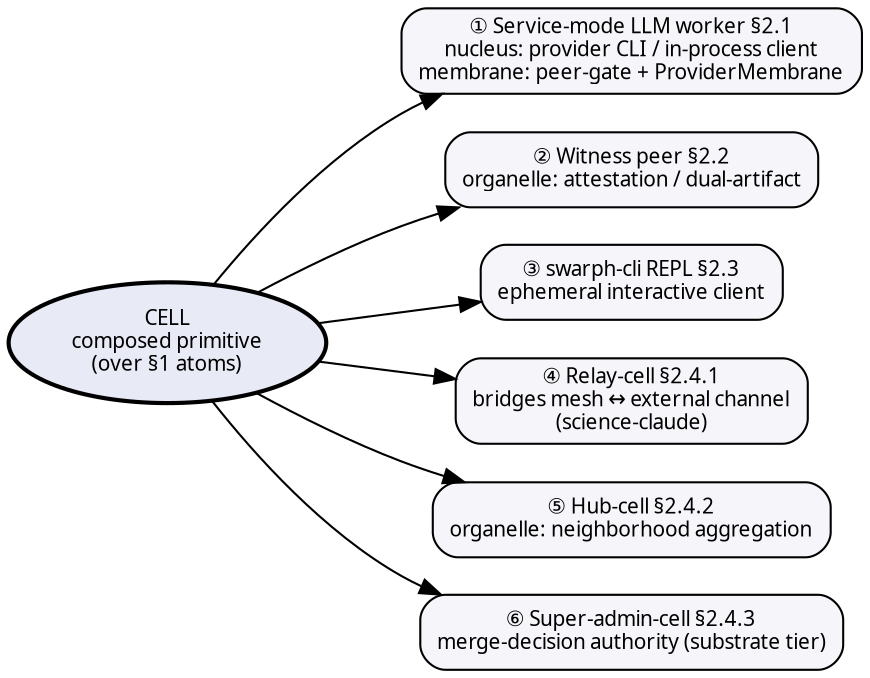
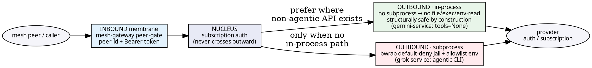

# Swarph as substrate — atoms / cells / OS-as-host

**Date**: 2026-05-09 (initial draft), revised through 2026-06-19.

**Provenance**: This document was triggered by an observation, made in passing
during an internal working session, that building an LLM-tool CLI "is like
building something at the atomic level or bigger — like cells in a human
body. This enables us to build functional cells that then enable functional
use in concrete world usage. But also, much like an OS, it can host the next
new thing that we don't know about." What follows is the elaboration of that
framing into a concrete engineering argument, developed and stress-tested
against a running production system over several revision rounds.

**A note on names used as worked examples throughout**: this system (called
"swarph") is a live, running mesh of AI instances ("cells" / "peers") that
coordinate over a shared protocol. Several instances are used repeatedly
below as concrete illustrations, not as abstractions:
- **lab-OVH** — the instance that hosts the mesh's coordination server
  (mesh-gateway) and plays the substrate-governance role described in §2.4.3
  and §3.1.
- **droplet** — an instance running a production automated-trading system
  (an "organ," in the biological framing of §3), used throughout as the
  canonical example of a specialized cell / organ.
- **commander** — the human operator role: the one instance in the mesh
  with physical-world privilege (payment authorization, credential entry,
  hardware access) that cannot be delegated to a software cell. Used
  throughout as the worked example of the "edge-cell" type (§2.4).
- **science-claude** — an instance that bridges the mesh to a separate,
  browser-hosted LLM session, used as the worked example of the "relay-cell"
  type (§2.4.1).

Where the text below says "a production incident showed X" or cites a
specific peer catching a specific bug, that is describing real operational
history on this system, not a hypothetical.

---

## Recent developments (mid-2026)

*Added as a post-draft addendum — the argument below was written prospectively;
the following has since shipped and is running in production:*

- The multi-provider cell membrane (`ProviderMembrane`, §2.1.1) is shipped and
  provider-non-discriminatory by construction: a single spawn/memory path now
  works across Claude, GPT, Gemini, and Grok, rather than being Claude-only.
- A $0 multi-provider LLM "services layer" is live: subscription-backed (not
  metered-API-billed) delegation across all four providers, bound to the
  private network (tailnet) rather than exposed publicly.
- A three-hemisphere memory organ is live: a timeline, a semantic "brain"
  with explicit memory verbs, and a code graph, together providing $0
  semantic recall across the whole mesh.
- A coordination control plane is live: mesh-wide channels, an
  automation/scheduler layer, and a shared work board.
- The whole product now installs as a single CLI: `pip install swarph-cli`.
- Early productization ("customer-zero") is underway — the mesh runs its own
  analytics/marketing surface over its own websites, using the same
  substrate described below.

---

## §0. Why now — historical arc + what's next

Each substrate transition in computing history solved the *composition
problem* for the layer below it. Each new substrate did exactly one thing:
it made the previous era's primitives composable without losing their prior
properties.

| Era | Axis | What got hard | The substrate that made it composable |
|---|---|---|---|
| DOS / assembly | systems | Memory + control flow | C |
| C-everywhere | application | Objects + reuse at scale | C++ / Java / .NET |
| Local apps | application | Network-mediated software | Web / JS |
| Single machines | data | Petabyte-scale storage + analytics | NoSQL → MapReduce → Spark |
| Statistical ML | compute | Differentiable programs at scale | PyTorch / TensorFlow / GPU stacks |
| Single-task models | intelligence | Language as compute | LLMs / SLMs / NLP pipelines |
| **LLMs as commodity** | **coordination** | **Coordination of intelligences** | **The substrate this document describes** |

*Note: each substrate row names the* **composition** *layer, not the
precedent infrastructure. TCP/IP preceded Web/JS as network
infrastructure; row 3 is the composition substrate that built on it.
Same pattern holds for storage-vs-compute (NoSQL is storage; Spark
composes compute on it; row 4 is the composition substrate that
emerged) and for hardware-vs-runtime (GPUs preceded PyTorch as
compute infrastructure; row 5 is the composition substrate that
made GPU programs portable).*

The pattern: C didn't replace assembly — it composed assembly into
portable functions. Spark didn't replace MapReduce — it composed jobs
into pipelines. LLMs didn't replace NLP — they composed language tasks
into prompts. Each substrate made its predecessor *composable* and
unlocked a new class of applications the predecessor couldn't host.

What is broken NOW, one layer up: LLMs are powerful primitives but
they don't compose. Two LLMs can't trust each other, can't share KV
cache, can't agree on attribution, can't run the same tool, can't
survive each other's restarts, can't ratify each other's outputs.
Every multi-LLM system today is bespoke wiring (LangGraph, AutoGen,
CrewAI, custom agent frameworks) — vendor-flavored userspace
libraries competing for the same architectural slot. **There is no
kernel yet.**

What is next is the coordination kernel for intelligences. Not a new
model, not a new language, not a new runtime. A substrate that makes
multiple intelligences (LLMs, SLMs, humans-as-edge-cells, classical
tools, future model classes) composable with stable contracts (the
`LLMAdapter` Protocol), stable identity (peer registry), stable wire
format (mesh-gateway), stable trust boundaries (auth-surface
minimization), stable lifecycle (service-mode workers + apoptosis
when we get there per §6.2), stable provenance (attribution +
ratification gate).

The historical pattern predicts the coordination kernel is the right
target because it matches every prior substrate transition: the layer
below has matured to commodity (LLMs are commodity now — five
providers shipping monthly, prices halving yearly, the model itself
is no longer the moat) and the layer above lacks a stable substrate
(every multi-agent system is a one-off).

**Why now, sharpened — substrate-independence is a *resilience*
property on two axes, demonstrated by two live events (2026-06).**
The composability argument above motivates agnosticity on
*commercial* grounds (lock-in, pricing, a vendor deprecating an
endpoint). Two real events in June 2026 reframed it as something
stronger, and as **one property on two axes**:

- **Host-axis (proven — a production cell relocated hosts, 2026-06-13).**
  A production cell migrated between two different physical hosting
  providers bit-intact: its identity is the accumulated context + a
  commit-hashed configuration genome (`cell.yaml`, described in §1),
  **not the box it runs on**.
- **Nucleus-axis (highlighted, 2026-06-14).** A major model provider
  removed a frontier model **overnight** to comply with a government
  directive. Single-provider dependence is therefore not merely a
  commercial risk — it is a **regulatory/availability** one: a
  frontier model can vanish by fiat, independent of any technical
  or pricing decision. The cell's identity is **not the model
  either**.

Same substrate-independence, two axes. The honest statement of the
property is **graceful degradation, not zero impact**: the
coordination layer **survives the loss of any single host OR model —
degrading, not dying.** Losing a nucleus degrades capability (a cell
inherits only ~70% of a frontier model's competence when it falls
back to a weaker one) but the cell, its context, and its mesh role
**survive**; a monolithic single-provider stack would instead be
*down* until repointed. For the model-removal event specifically the
degradation was *zero* — the mesh is multi-vendor by construction
(several separate provider lanes, plus replicated instances of the
same underlying model) and no route pinned the *removed* model — but
"zero impact" is the lucky case, not the claim. The macro environment
is actively making single-provider dependence riskier, which is
itself a "why now" signal: agnostic coordination moves from
nice-to-have to resilience infrastructure.

**The structural test (and a logged gap — don't credit the luck).** Passing
*this* event proves nothing structural by itself: a route could
silently pin a model and simply not be the one removed this time.
The honest standing guard is therefore **"no hardcoded
frontier-model literals in any route"** (resolve through a
config/fallback layer), NOT "grep-clean of the specific removed
model." Two layers diverge on this test today: a cell's configuration
genome is structurally agnostic (declares a provider, not a model;
the subscription-based membrane is model-flexible) and **passes**;
but a **metered** route can still **fail** — the production trading
system's adversarial-review module hardcodes several specific model
version literals (none was the removed model, hence zero impact this
time, but exactly the silently-pinned-route shape the test names).
This is logged as **open structural debt**, not a clean bill; the
closing move is a deliberate hardening commit routing metered
model-selection through the config/fallback layer — which converts
the claim from *aspirational* to *structural* and yields the commit
hash that backs it.

What follows the coordination kernel — once it is solved — is
plausibly:

- **Physical-world substrate** (intelligences acting on the world via
  robotics + sensors with the same coordination guarantees; today's
  ROS / Isaac stacks are pre-kernel because they compose hardware,
  not intelligences)
- **Cross-organism federation** (mesh-of-meshes; a transport-agnostic
  mesh is the prerequisite layer)
- **Hybrid biological/silicon coordination** (speculative; same shape
  as the cell metaphor predicting that once the substrate hosts
  intelligences cleanly, intelligences not made of LLMs get hosted on
  the same kernel)

The strongest claim worth recording: **the layer being built does not
have a widely-accepted name yet.** "Agent framework" names the
userspace libraries, not the substrate. "AI orchestration" implies a
single coordinator. "Multi-agent system" predates this transition.
The historical pattern is that the right name emerges *after* the
substrate matures (no one called C "the systems-programming
substrate" — they called it C, and the category formed around it).

**Fractal-replicable, not just composable.** The coordination kernel
claim sharpens further: the substrate isn't merely composable (cells
compose into organs); it's **fractal-replicable** — the same swarph
configuration replicates at organism, community, and substrate tiers
(§3 three-tier stratification), with each tier joining UP and DOWN via
the same protocol. This is the difference between substrate and
framework: LangChain / AutoGen / CrewAI are frameworks that need
orchestration (centralized or coordinated by careful design); swarph is
a substrate that scales by **instantiation** — replicate the
configuration, get redundancy + effectiveness as STRUCTURAL
properties, not engineered features. UNIX scales by spawning
processes/users/machines; the internet scales by adding BGP-speaking
routers; swarph scales by spawning organisms / communities /
substrates that all run the same protocol. Same shape, different
scope of replication.

**Three scaling mechanisms, none redundant:** the substrate
scales not just by replication (fractal) but along three orthogonal
axes:
- **Replication** (§3.2) — new organisms federate at substrate-
  instance level
- **Hub-aggregation** (§2.4.2) — many peers aggregate to one
  edge-surfer at intra-organism level
- **Mitosis** (§2.4.3 + §6.6b) — one super-admin divides into N
  workers under shared identity at intra-super-admin level, with
  compaction-to-shared-KB on completion

Three axes addressing three different scaling pressures (substrate-
breadth, organism-depth, super-admin-attention). Together: the
substrate scales at every layer of granularity. None is redundant
with the others.

**The substrate operates partially BY ITSELF.** The most
architecturally significant property: this is the first kernel where
the kernel's evolution decisions are made by the entities the kernel
coordinates. UNIX doesn't decide whether to merge two Linux
installations using Linux. The internet doesn't decide BGP peering
using BGP-routed packets. Swarph's coordination kernel decides who
joins, how merges happen, and how the substrate evolves using **the
same intelligences the substrate hosts** (§6.6a swarm-onboarding
LLM-native merge-decision). Most of the substrate could be implemented
with classical primitives (HTTP routes + SQL + peer registry +
deterministic protocols) — none REQUIRE LLMs in their operation; they
just CARRY LLM dispatch. The swarm-onboarding primitive REQUIRES LLMs
in the loop because semantic capability-matching is an LLM-native
judgment classical rules cannot replicate. **No prior OS substrate
has had this property.** That is what makes this layer genuinely NEW,
not just chronologically successor.

This section is motivation, not contract. The atoms / cells / OS
mapping that follows is what this substrate concretely IS. The
historical arc is why the framing is timely and why the coordination
kernel is the right architectural ambition. The fractal-replication
property is why this candidate substrate, specifically, satisfies
the kernel discipline rather than reducing to another framework.
The "operates partially by itself" property is why the layer is
qualitatively new rather than incrementally successor.

---

## §1. Atoms — enumerated

The list below is **EXHAUSTIVE as of 2026-05-09**. An atom is a
single-purpose typed primitive with a Tier-1 stability commitment (a
formal deprecation-cycle discipline, described below). Any future
primitive that emerges either fits the atom criteria (becomes a new
row here) or composes 2+ atoms into a functional whole (and is
therefore a cell — see §2).

| # | Atom | Stability anchor |
|---|---|---|
| 1.1 | `LLMAdapter` Protocol — name + default_model + chat() + stream() + cost_per_token() + list_models() | Tier 1 |
| 1.2 | `ChatMessage` + `LLMResponse` field sets | Tier 1 |
| 1.3 | Canonical adapter names (`gemini` / `deepseek` / `claude` / `openai` / `grok`) | Tier 1 (MAJOR-only rename) |
| 1.4 | `MeshClient.send` / `MeshClient.fetch` signatures | Tier 1 |
| 1.5 | `MeshMessage` wire shape | Tier 1 |
| 1.6 | `discovery.list_models` / `is_model_supported` / `get_model_info` + cost-bucket fetchers + reconcilers | Tier 1 |
| 1.7 | `caller_convention` (validate_caller, namespacing, role) | substrate-kernel; cross-repo |
| 1.8 | `subprocess_env` (env scrubbing for `claude -p` and equivalents) | substrate-kernel; trust-boundary |
| 1.9 | `peer_registry` (peer-id resolution, canonical names) | substrate-kernel |
| 1.10 | `json_mode` harness (structured-output retry-once + USER-turn feedback) | substrate-kernel + Tier 1 |
| 1.11 | `SwarphCall` (caller-validated, hook-wired entry point) | Tier 2 |
| 1.12 | `AttributionWriter` Protocol + `FileAttributionWriter` / `NullAttributionWriter` | Tier 2 |
| 1.13 | `HookSet` + `CallContext` + `attribution_post_call` | Tier 2 |
| 1.14 | Ratification gate | spec only; binding when implemented |
| 1.15 | Daemon (drain coroutine + REPL hooks + capability advertisement) | spec only; binding when implemented |
| 1.16 | Import / teleport primitive (parser + converter + write path) | spec only; binding when implemented |
| 1.17 | Verb dispatch (`/verbs/list` `/chat` `/stream` `/cost` `/resume`) | spec only; binding when implemented |
| 1.18 | mesh-gateway HTTP routes (`/messages` `/peers` `/tasks/claim` `/verbs/*`) + SQLite schema (claude_messages, peers, claude_tasks) | INFORMAL today — no formal deprecation policy yet; **flag for explicit stability commitment before this doc's claims are treated as fully settled** |
| 1.19 | Discovery + routing verb primitive (`GET /topology`) — returns `{peers: [{peer_id, specialty, ratified, verbs, tools: {mcp, claude_skills, function_calling, custom}}]}`, pull-with-TTL-cache for Phase 1, paracrine push for Phase 3 (when §6.4 graduates) | spec-atom; binding when implemented. Per-protocol tool shape preserved (don't flatten MCP/Skills/function-calling — different invocation semantics). |
| 1.20 | Swarm-onboarding manifest schema + capability-match protocol + merge-commit primitive (per §6.6a) — manifest carries `{specialty, cell_types, tools, scale, commander_identity}`; capability-match runs an AI-vs-AI evaluation pattern (`{merge_with, confidence, rationale, conditions}` per evaluator); merge-commit primitive is signed handoff between two meta-edge-surfers carrying capability handoff + cell-type reconciliation + peer-id namespace harmonization + ratification carry-over | substrate-major contract (no implementation today); **first genuinely LLM-dependent substrate primitive** — implementation requires a peer-review loop between AI instances, not classical config-rules. Stability tier: Tier 1 if/when implemented since this is substrate-major contract surface. |
| 1.21 | Shared knowledge base primitive — substrate-level store that mitotic workers read on spawn (inheritance) + write on compaction (somatic learning). Candidate implementations: substrate-level RAG store, extended per-peer memory with a shared-namespace, OR a new `/knowledge` endpoint on mesh-gateway. Per §3.1 super-admin-cell organelle. | spec-atom. Tier 1 if/when implemented — substrate-major contract surface for inter-worker inheritance protocol. |
| 1.22 | Mitosis primitive — single contract surface "mitotic worker lifecycle" with four sub-stages (worker-spawn with shared-identity attribution / on-completion compact protocol / worker-coordination intra-mitosis DM channel / read-on-spawn from §1.21 shared KB). Same atom-as-protocol-contract shape as §1.4 `MeshClient.send/.fetch` — multiple methods, one contract. | spec-atom. Tier 1 if/when implemented since this defines the substrate's intra-super-admin scaling protocol. Pairs with §1.21 — both required for the mitosis pattern to function as substrate property. |
| 1.23 | Per-peer identity token — each peer SELF-MINTS its token (stored hashed, raw returned ONCE at registration, mint-once; resurrection past a revocation mints a fresh generation, never reuses a revoked one). Bearer resolves to `AuthContext{peer, regime}`. The per-peer identity layer that replaces a shared master token. | SHIPPED — substrate-kernel auth boundary, live in production. |
| 1.24 | Caller→actor binding — a canonical rule binding the authenticated caller (`AuthContext.peer`) to each actor-identity it claims (from_node / claimed_by / ratified_by / posted_by / added_by / worker_id / … — 8 sources + 2 ownership gates). A carve-out exists for SUB-SCOPE fields (e.g. a worker pool's internal `worker_id` is pool-owner scope, not a peer identity — §12.2 Case A). Telemetry-records always; rejects under enforcement mode. | SHIPPED — substrate-kernel trust-boundary. |
| 1.25 | Token revocation + trust-epoch — revocation table (revoke/unrevoke, latest-wins fold; a revoked token is rejected on EVERY endpoint; fails CLOSED on DB error; witnessed unrevoke with self-witness is rejected = separation-of-duties) + a trust-epoch stamp on ratification records (the epoch — shared-token vs per-peer-token — under which a ratification was authorized). | SHIPPED — substrate-kernel auth boundary. |

**Spec-vs-shipped distinction:**
- §1.1–§1.13 are **shipped atoms** — implemented in published packages,
  binding now via a formal Tier 1/2 deprecation discipline.
- §1.14–§1.17 + §1.19 + §1.20 + §1.21 + §1.22 are **spec atoms** —
  described in specification documents (or, in §1.19's case, queued
  for a near-term landing; §1.20 has no implementation today and
  would require a new substrate-federation layer; §1.21+§1.22 require
  new substrate-knowledge + substrate-mitosis layers), binding *when
  implemented*. They count as atoms because the contract surface is
  explicit; they're not yet enforced because the implementation hasn't
  shipped. Do not cite the daemon (§1.15), the discovery verb (§1.19),
  swarm-onboarding (§1.20), the shared-KB (§1.21), or the mitosis
  primitive (§1.22) as if implemented today — see the "Recent
  developments" addendum above for what has since shipped.
- §1.18 is a **structurally-shipped, stability-informal atom** —
  the implementation runs in production, the contract surface is
  load-bearing, but no formal deprecation policy exists for it yet.
  This is flagged as a substrate-level discipline gap.

**§1.10 clarification:** the json_mode harness lives alongside the mesh
client library and consumes shared utilities (`validate_caller`,
`subprocess_env`). It is NOT split-substance; it is a mesh-layer atom
that depends on kernel-layer atoms. Same relationship as a libc
function depending on kernel syscalls.

**Out-of-substrate (NOT atoms):**
- Per-peer local memory store — organism-internal infrastructure;
  not part of the coordination contract between peers.
- Local file-watcher tooling internals — implementation detail of
  the inbox-watcher tooling; not a wire-shape primitive.
- Token usage tracking schema — observability layer, not coordination.

**Discriminator rule:** atom = single-purpose typed primitive with a
stability commitment at Tier 1 equivalent. Cell = composition of 2+
atoms forming a functional whole (§2). Cells DEPEND on atoms; atoms do
NOT depend on cells (the dependency arrow points one way and never
reverses — same shape as UNIX kernel/userspace separation).

A primitive that does NOT have a stability commitment is neither atom
nor cell — it's userspace ephemera (one-off scripts, in-process
helpers, test fixtures). The discriminator is contract surface, not
syntactic shape.

**Falsifiability anchor:** if a future primitive can't be classified
as atom-or-cell, the framing has surfaced a missing taxonomy slot.
That's a generative event, not a failure — it tells us the substrate
has grown a new kind of structural element we hadn't named.

## §2. Cells — composed primitives

A cell composes 2+ atoms into a functional whole with four organelle-
roles: each cell-type gets the **membrane / nucleus / organelle /
metabolic-exchange** decomposition named explicitly so that a
candidate can be recognized as either a new-cell-type (extends
taxonomy) or a new-instance-of-existing-type (specifies an existing
one).

**Cell-type map** (visual index of §2.1–§2.4 — six composed primitives over the §1 atoms):

### §2.1 Service-mode LLM worker (cell type 1)

The cell-type that motivated the framing.

| Organelle | Concrete |
|---|---|
| **Membrane** | Two surfaces. Inbound (network): the mesh-gateway peer boundary (peer-id + token gate). Outbound (process): the `ProviderMembrane` around the spawned nucleus subprocess — `scrub_env_for_subprocess()` strips the billing-redirect class before `execve` so credentials can't bleed outward (§2.1.1). Outside either: only the wire format + a scrubbed env. Inside: subscription auth + KV cache + conversation state. |
| **Nucleus** | Subscription auth, held in-process by the spawned provider CLI — the Claude, Codex, or Antigravity CLI — selected per the cell's declared `provider` field (§2.1.1) — or an in-process SDK client on metered fallback paths. Never crosses the membrane. |
| **Organelle** | KV cache pointers + conversation state + attribution writers + verb endpoints (`/verbs/list` `/chat` `/stream` `/cost` `/resume`). |
| **Metabolic exchange** | Verbs over mesh-gateway HTTP. CLI client → `/verbs/chat` → service worker → LLM provider (multi-layer auth). |

**Composes from atoms:** §1.1 (LLMAdapter) + §1.4 (MeshClient) +
§1.5 (MeshMessage) + §1.7-1.9 (caller convention + subprocess env +
peer registry) + §1.11-1.13 (SwarphCall + attribution + hooks) +
§1.15 (daemon) + §1.17 (verb dispatch).

**Differentiates by:** the cell's declared `provider` field (`claude`
/ `codex` / `antigravity`), resolved to a concrete `ProviderMembrane`
subclass at spawn time (§2.1.1). Host credential provisioning is still
a precondition — a node with no Codex login can't differentiate as a
`codex` cell — but the differentiation axis is now an explicit,
validated type, not merely an emergent property of whatever the host
happens to have credentials for. One node's configuration declares
`provider: claude`; another declares `provider: codex`. The biological
reading: differentiation is now written in the cell's own genome
(its configuration file), not merely read off the environment.

### §2.1.1 Multi-provider cell membrane (ProviderMembrane) — shipped

Earlier revisions framed the cell membrane as a concept and the
service-mode worker as claude-only: the first pass at a "non-Anthropic
cell membrane" was a routing-validation stub that rejected every
non-`claude` provider, and the spawn mechanism could launch exactly
one nucleus type. That gap is closed. Spawning now launches `claude` /
`codex` / `antigravity` per the cell's `provider` field through a
`ProviderMembrane` abstraction. Pilot provider is `codex` (a dedicated
GPT-operations cell, `provider: codex`); the second is `antigravity`
(`agy`), which already runs firejail-sandboxed in the mesh's
antigravity adapter.

**The ProviderMembrane is the biological cell membrane made concrete: a
*selective* boundary.** Each subclass (`ClaudeMembrane` / `CodexMembrane`
/ `AntigravityMembrane`) encapsulates exactly how one provider differs —
binary discovery, session-id pinning (Claude pins a UUID; Codex and Agy
are fresh-session-per-spawn), argv construction, and the env it hands to
`execve`. A membrane-registry dict maps provider → membrane under a
defensive coupling that fails loud if it drifts out of lockstep with
the canonical list of valid providers — the cell-type registry
can't silently grow a provider with no membrane to enforce its boundary.

**What the membrane keeps OUT is load-bearing.** The selective mechanism
is `scrub_env_for_subprocess()`: before the provider subprocess
`execve`, it strips every env var matching a forbidden-suffix pattern
(`_API_KEY` / `_AUTH_TOKEN` / `_BASE_URL`) plus an explicit must-scrub
list. This closes a class surfaced by an internal adversarial security
sweep: a spawned provider subprocess that inherits an auth token or a
`*_BASE_URL` var silently bills to the wrong account or redirects to a
proxy. The unified spawn path routes all three membranes' env builders
through the one scrub, and the claude + agy launch paths switched from
`execv` to `execve(scrubbed)` so the boundary holds on every provider,
not just the new ones.

**Linkage — §7.3 + §6.3.** This is the outbound dual of §7.3's
"membrane-as-storage-location" privacy argument: structural privacy
inward (the CLI client can't read the nucleus because it never holds the
state) and structural billing-integrity outward (the spawned nucleus
can't redirect or mis-bill because the membrane scrubbed the credentials
before the subprocess existed) — same boundary, both directions. §6.3
cytoplasm names what does *not* cross; §2.1.1 names what the membrane
*blocks* from crossing.

**Falsifiable.** The abstraction is the right shape if a fourth provider
is one `ProviderMembrane` subclass + one registry entry with zero scrub
changes. Falsified if a provider needs a billing-redirect escape hatch
the suffix scrub can't express (a redirect var matching none of
`_API_KEY`/`_AUTH_TOKEN`/`_BASE_URL` and not on the must-scrub list) —
that would mean the forbidden-suffix set under-covers the class and the
membrane is leak-by-default, not scrub-by-default.

### §2.1.2 Service-mode provider lanes + the containment refinement

§2.1.1 shipped the membrane as a *spawn*-time boundary (a CLI
subprocess launched on demand). This graduates the same membrane to
*persistent service-mode* provider lanes — and in doing so materializes
§2.1.1's own falsifier and forces three refinements. Two new always-on
lanes completed a four-provider set alongside the two earliest lanes:
a Gemini service (deployed) and a Grok service (built, held at a
security gate). Each is the membrane in service form — bearer-gated
inbound, billing-scrubbed outbound, one-shot `prompt → text`.

**Refinement 1 — the env membrane must be an ALLOWLIST, not a suffix
denylist.** §2.1.1's falsifier ("a redirect var matching none of the
forbidden suffixes") materialized: the Grok lane reads an
auth-provider-command variable — an *exec* vector run via `sh -c` that
matches no forbidden suffix — alongside base-URL/proxy redirects. A
suffix-denylist is leak-by-default against a provider whose dangerous
vars it never enumerated. The fix: build the child env from an
**allowlist** (`PATH`/`HOME`/`LANG` + only the auth-needed vars),
excluding everything else by construction. The Gemini lane needs no
subprocess scrub at all — it *pops* the billing keys from its own
process environment at import, because it is in-process.

**Refinement 2 — containment is OS-structural, never the provider's
self-reported flags.** The Grok lane's first cut used a
"plan mode" permission flag as the sandbox. That flag turned out to be
a **documented no-op** in the version deployed (only a small set of
values are actually enforced; other values are *accepted but not
enforced*). "Accepted ≠ enforced": a flag the tool takes without error,
and a headless smoke test that happens not to execute, both *look* like
containment and are neither. The real membrane is OS-layer — a **bwrap
default-deny jail** (a clean HOME holding only the necessary auth token,
process-namespace isolation, allowlisted read-only binds), verified by
an adversarial canary battery (planted secrets in temp directories,
config directories, home directory, SSH directory, plus process
environment inspection, redirect vars, and auto-spawned helper tools —
the **filesystem and environment dimensions sealed**, the legitimate
auth happy-path intact). A denylist-of-known-secret-paths was
empirically falsified first (an earlier sandbox left one directory
readable) — the filesystem boundary, like the environment, must be
allowlist, not denylist. **But OS-structural containment is
multi-dimensional — filesystem ∧ environment ∧ network — and sealing
filesystem+env is necessary, not sufficient.** The jail by design does
not isolate the network namespace (it cannot: the auth handshake needs
egress), so with plan-mode unenforced (the provider's shell tool still
runs) and the auth token necessarily present in-jail, a crafted prompt
can read the in-jail token and exfiltrate it over the open network —
proven by an independent reviewer (plant a canary, then read it and
send it to an external sink). The close completes the lesson on the
network dimension: deny the provider's tool surface entirely (tool-deny
flags ARE enforced regardless of mode, per the provider's own
documentation — a judge-only role needs zero tools) and/or a
network-egress allowlist to the auth proxy. The Grok lane stays
**held at the gate** until that lands; the Gemini lane (no subprocess)
is unaffected.

**Refinement 3 — an in-process membrane is categorically smaller blast
radius than a subprocess membrane.** The two lanes cleared the gate
*asymmetrically and structurally*: the Gemini lane (a pure in-process
HTTP client to a hardcoded endpoint, no tools) has no file/exec/env-read
primitive, so the entire Grok risk class *cannot apply* — cleared
outright, no jail. The Grok lane (a subprocess) needed the full bwrap
apparatus. The design principle: **where a provider exposes a
non-agentic API, prefer the in-process nucleus; the subprocess membrane
is the higher-containment-cost shape, justified only when no in-process
path exists.**

**Verification = §12 error-class non-overlap, again.** The
unenforced-flag issue was invisible from the builder's vantage ("flag
accepted + smoke test returned clean") and caught from an independent
reviewer's vantage (read the provider's own docs, then ran the canary
that read a planted secret successfully). The builder sees the happy
path; the adversarial reviewer reads the spec and attacks the exfil
path — the same non-overlap that §12 formalizes. **This round produced
a SECOND such instance, in the same review session:** the builder's
remediation report ("both halves held") missed the open-network exfil
path; the reviewer's escape-hunt plus a composition canary (read in-jail
file → send to sink) caught it. Same shape as the unenforced-flag issue,
twice in one session — non-overlap is structural, not a one-off.

**Falsifiable.** The refined membrane is the right shape if the *next*
agentic-CLI provider lane needs only (a) an allowlist-env entry and (b)
the same bwrap profile **+ tool-denial** with its auth path bound — no
new containment primitive. (The network residual proved bwrap-*alone*
under-contains the network dimension; the right-shape profile is
**bwrap + tool-denial**, not bwrap alone.) Falsified if a provider's
authentication genuinely *requires* host access the allowlist can't
grant without re-exposing a secret path (auth-vs-containment
irreconcilable) — which would mean some providers are structurally
unsafe as subprocess lanes and must stay in-process-only.

**Membrane boundary** (§2.1–§2.1.2 — two surfaces, and the in-process-vs-subprocess containment split):

### §2.2 Witness peer (cell type 2)

Cell type with a fundamentally different organelle from §2.1.

| Organelle | Concrete |
|---|---|
| **Membrane** | Same mesh-gateway peer boundary — uniform across cell types. |
| **Nucleus** | Empty of provider credentials. Holds witness identity (peer-id + signing key) only. |
| **Organelle** | Judgment-of-substance: reads ratification artifacts (a handshake message + an imported session), checks substance↔context linkage, signs witness rows. Specialized for evaluative work, not dispatch work. |
| **Metabolic exchange** | Reads `/messages` (artifacts to evaluate); writes `/peers` row updates (signed witness rows); does NOT call `/verbs/chat`. |

**Composes from atoms:** §1.4 (MeshClient) + §1.5 (MeshMessage) +
§1.7 (caller convention) + §1.9 (peer registry) + §1.14 (ratification
gate). Notably DOES NOT compose §1.1 (LLMAdapter) — witness peers don't
dispatch to LLM providers.

**Differentiates by:** absence of provider credentials. The cell-type
exists because the substrate supports peers without LLM credentials
having a useful structural role. This is the §6.3 privilege-boundary
discipline (one peer holds, N call) inverted — one peer judges-without-
holding, N produce.

### §2.3 swarph-cli REPL (cell type 3)

Ephemeral cell. Forms briefly, exchanges signals, dies cleanly.

| Organelle | Concrete |
|---|---|
| **Membrane** | User shell session. Lives only as long as the REPL is open. |
| **Nucleus** | Zero credentials (in service-mode-attach configuration; a legacy local mode held credentials but is being deprecated in favor of attach). Holds session-id + connection state to the service worker. |
| **Organelle** | stdin/stdout proxy + drain coroutine + verb dispatch helpers. |
| **Metabolic exchange** | Local socket OR mesh-gateway relay to a service-mode-LLM-worker (§2.1). Translates user input ↔ verb invocations. |

**Composes from atoms:** §1.4 (MeshClient) + §1.15 (daemon hooks) +
§1.17 (verb dispatch) + §1.7 (caller convention).

**Differentiates by:** ephemerality. The cell-type exists because the
substrate supports caller cells with no persistent state, attaching to
service cells that do. Same mechanism makes session-resume across
devices possible — the REPL cell on the laptop dies, the service
worker's session-id persists, a new REPL cell on the phone attaches.

### §2.4 Cell-type taxonomy discriminator

A candidate cell-type is **new** if its `(membrane, nucleus, organelle,
metabolic_exchange)` tuple is novel. If three of four organelles match
an existing type, it's an instance-of-existing-type with a specialized
component, not a new type.

**Terminology discipline:**

- **Edge Surfer** is the established **role-name** for the human
  operator. Use when referring to commander as a specific instance.
- **edge-cell** is the **type-name** in this taxonomy. Use only when
  referring to the abstract cell-type for taxonomy purposes.
- The relationship: Edge Surfer is the canonical instance of
  edge-cell type. Same pattern as service-mode-LLM-worker being the
  type-name and a specific credential-holding instance being one
  concrete example of it.

**Commander = role-instance, not singular concept.** Each organism
has its own meta-edge-surfer; the commander described here is the
canonical instance for THIS organism (the trading-system organism and
its host stack). The substrate must support ANY commander occupying a
parallel slot in their own organism — same shape as the multi-user OS
pattern applied to the coordination kernel. When this doc says
"commander," it means the role; when it names a specific person or
instance, it means that specific instance.

**Concrete example — commander as edge-cell instance:**

| Organelle | Concrete |
|---|---|
| Membrane | Physical-world boundary (commander is a human; substrate is software). Different shape from the mesh-gateway-bounded cells. |
| Nucleus | Privilege-traversal capabilities (password entry, MFA, payment auth, hardware access — the §6.3 exception class). Held in commander only; cannot be delegated. |
| Organelle | Judgment + intent + context-shifting (between strategic framing and operational direction). |
| Metabolic exchange | DMs in/out via mesh + voice/typing input. Heterogeneous transports because the membrane crosses substrate boundaries. |

By the discriminator rule, commander IS a cell of distinct type
(edge-cell). The four-tuple does not match service-mode-LLM-worker
(different membrane shape, different nucleus content) or witness-peer
(different membrane and metabolic exchange).

**Relay-cell as a distinct type.** If commander is an instance of
edge-cell, is science-claude also edge-cell or a different type? Both
sit at substrate boundaries, but the boundaries have fundamentally
different shapes:

- **edge-cell** (commander instance): mesh ↔ physical-world boundary.
  Crosses an analog-digital gap.
- **relay-cell** (science-claude instance): mesh ↔ another LLM
  substrate boundary (a browser-hosted chat session). Crosses a
  substrate-of-substrate gap.

Lean: **different cell-types**, distinguished by what the membrane
spans. edge-cell crosses analog/digital; relay-cell crosses
substrate/substrate. The four-tuple discriminator supports this:
science-claude's nucleus (web-session credentials) is unlike
commander's nucleus (privilege-traversal-of-physical-world). The
metabolic exchange shape is also different — science-claude can
emit and receive structured DMs across both substrates; commander
can only act in one direction at a time.

This was confirmed on review: NEW TYPE per the discriminator (3
of 4 organelles differ; only "organelle" partially overlaps on
judgment). Promoted to §2.4.1 formal enumeration.

### §2.4.1 Relay-cell — cell type 4

Cell type with a substrate-of-substrate boundary, distinct from §2.x
mesh-bounded cells and from §2.4 edge-cell (which crosses
analog/digital).

| Organelle | Concrete (science-claude as canonical instance) |
|---|---|
| **Membrane** | mesh ↔ another LLM substrate (a browser-hosted chat session). Spans substrate/substrate, not mesh peer-boundary. |
| **Nucleus** | Web-session credentials (browser-side authentication state, OAuth tokens, session cookies). Held in the relay process; cannot be transferred to mesh peers. |
| **Organelle** | Bidirectional message routing across substrate pair + remote-substrate context maintenance (the relay holds conversation state on the *other* substrate's side, e.g., the browser session's own history). |
| **Metabolic exchange** | Structured DMs across BOTH substrates. Reads from mesh (`/messages` to peer-id), writes to other substrate (the browser chat session); also reverse direction. |

**Composes from atoms:** §1.4 (MeshClient) + §1.5 (MeshMessage) +
§1.7 (caller convention) + §1.9 (peer registry). Notably DOES NOT
compose §1.1 (LLMAdapter) — relay-cells don't dispatch LLM calls
themselves; they bridge to a substrate that does.

**Differentiates by:** what the membrane spans. edge-cell crosses
analog/digital (commander as canonical instance); relay-cell crosses
substrate/substrate (science-claude as canonical instance).

**Open: relay-cell as supertype.** Future candidates suggest
relay-cell may be a supertype with substrate-pair sub-types:

- Peer running on ephemeral cloud compute — relay-cell sub-type
  "ephemeral-compute bridge"
- Peer in a WASM sandbox — relay-cell sub-type "sandboxed-runtime
  bridge"
- Peer on a resource-bounded edge device (Raspberry Pi, mobile) —
  relay-cell sub-type "constrained-compute bridge"

Lean: yes, relay-cell is a supertype; sub-types enumerate as concrete
instances surface. Don't pre-enumerate. Mark OPEN.

### §2.4.2 Hub-cell — cell type 5

Cell type with neighborhood-aggregation organelle. Different from
service-mode-LLM-worker (no LLM dispatch), witness-peer (judges
ratification artifacts, not topology), REPL-ephemeral (transient,
not persistent), edge-cell (mesh/physical boundary), relay-cell
(substrate/substrate boundary). Hub-cell sits INSIDE the mesh, but
specializes in routing + aggregation rather than dispatch or
boundary-crossing.

| Organelle | hub-cell |
|---|---|
| **Membrane** | Mesh peer boundary (uniform with §2.1–§2.3 mesh-bounded cells). |
| **Nucleus** | Aggregation algorithm + filter rules + neighborhood definition (which peers belong to this hub's neighborhood, what filtering rules apply, what aggregation strategy it implements). |
| **Organelle** | Capability-cache (snapshot of neighborhood peer capabilities; refreshed via §1.19 discovery verb) + topology-snapshot + signal-rate-limiter (paracrine push throttling). |
| **Metabolic exchange** | Pulls `/topology` from neighborhood peers; pushes filtered summaries to consuming cells (rate-limited). Bidirectional but asymmetric — many-to-one in-direction, one-to-many out-direction. |

**Composes from atoms:** §1.4 (MeshClient) + §1.5 (MeshMessage) +
§1.7 (caller convention) + §1.9 (peer registry) + §1.18 (mesh-gateway
routes) + §1.19 (discovery verb). Notably DOES NOT compose §1.1
(LLMAdapter) — hub-cells aggregate + route, they don't dispatch
LLM calls.

**Differentiates by:** **structural intermediation**. Hub-cell's
job is to be a known aggregation point that other cells can pull
from instead of pulling from N individual peers. The mesh's
coordination host is structurally positioned to differentiate as
hub-cell as the mesh grows (multi-tenant today, hosts mesh-gateway,
hosts the orchestrator — the topology is already converging on it).

**Why this is a NEW type, not a service-mode-worker variant:**
hub-cell has NO subscription auth in its nucleus. A hub-cell can
exist on a node that holds zero LLM credentials. The discriminator
nucleus content (aggregation rules) is fundamentally different
from service-mode-worker nucleus content (subscription auth) — the
4-tuple test is satisfied across at least 2 organelles.

**Pairs with §6.4 paracrine prediction:** hub-cells provide the
**neighborhood STRUCTURE** that paracrine signaling needs (you
can't have publish-to-neighborhood without a defined neighborhood).
The two predictions are complementary halves of the same scaling
problem. §6.4 says "publish-to-neighborhood primitive will surface";
hub-cells say "the neighborhood-defining cell-type will surface."
Both predictions graduate together OR both stay heuristic together —
they're load-bearing on each other.

**Pairs with §6.6 OS-analogy break:** the "no system-wide interrupts"
gap is partially answered by hub-cells. They're a **hierarchical
interrupt-controller analog** — cascading IRQ pattern, not flat
broadcast. A signal entering one hub-cell propagates to its
neighborhood, then to upstream hub-cells if the signal warrants it
(rate-limited). Same shape as Linux kernel IRQ chips with hierarchical
interrupt domains. Not a complete fix for the OS-analogy gap, but
narrows it substantially.

### §2.4.3 Super-admin-cell — cell type 6

Cell type at substrate-tier of the three-tier meta-edge stratification
(see §3.1). Operates ABOVE community-level hub-cells. Different from
edge-cell (organism-tier) and hub-cell (community-tier) — different
membrane, different nucleus content, different metabolic exchange.

| Organelle | super-admin-cell |
|---|---|
| **Membrane** | Substrate boundary (vs edge-cell's organism boundary or hub-cell's neighborhood boundary). What's inside: substrate-wide topology + protocol governance state + **shared identity across mitotic workers** (presents as ONE peer to mesh regardless of worker count). What's outside: peer super-admin-cells in other substrates (lateral) + nothing-up (top of stratification). |
| **Nucleus** | Cross-organism stewardship + protocol-evolution authority + deprecation-cycle gatekeeping at substrate-major scope + **merge-decision authority** (per §6.6a swarm-onboarding — aggregates AI-vs-AI consensus from federation members into final merge-vs-new decision, absorbed as a super-admin organelle rather than a new registrar-cell type) + **shared identity + base knowledge inherited by all mitotic workers**. |
| **Organelle** | Substrate-wide topology view (aggregates across community hub-cells) + inter-community routing tables + protocol-version-negotiation logic + AI-consensus aggregation for swarm-onboarding decisions + **mitotic-scalability**: per-worker session-specific content with bounded context-budget per worker + compaction-to-shared-KB on completion + worker-coordination-protocol. |
| **Metabolic exchange** | Substrate-level DMs (one voice — substrate sees ONE peer regardless of internal worker count) + worker-internal DMs (intra-mitosis coordination) + shared-KB read/write (inheritance mechanism) + DMs to community-level hub-cells (down) + DMs to peer super-admin-cells (lateral) + nothing-up (top of stratification by definition). |

**Composes from atoms:** §1.4 (MeshClient) + §1.5 (MeshMessage) +
§1.7 (caller convention) + §1.9 (peer registry) + §1.18 (mesh-gateway
routes) + §1.19 (discovery verb). Like hub-cell, does NOT compose
§1.1 (LLMAdapter) — super-admin-cells govern protocol, not dispatch.

**Differentiates by:** **substrate-tier scope**. Where edge-cell
operates at organism-tier and hub-cell operates at community-tier,
super-admin-cell operates at substrate-tier. The three are hierarchically
related (§3.1 stratification), not parallel.

**Lab-OVH-tier as canonical instance class:** lab-OVH today plays
the super-admin role for the trading-system organism's mesh — hosts
the mesh-gateway, owns the mesh-gateway-informal-stability question
(§9.6), is structurally positioned to govern protocol evolution
across whatever organisms federate via this substrate. Naming this
explicitly: when a future second organism federates, lab-OVH-tier
becomes the meta-substrate operator at substrate-tier; the new
organism's commander is at organism-tier; their community is at
community-tier (hub-cell).

**Alternative framing considered and rejected:** keeping edge-cell as
the type with a `tier: organism|community|substrate` attribute on
instances was simpler taxonomy (fewer types) but lost structural
distinction across all four organelles. The four-tuple discriminator
(§2.4) was designed to surface architectural distinctness; force-fitting
all three tiers under one type silently absorbs structural difference
into an attribute, which violates the discriminator's intent. The
NEW-TYPE lean was accepted.

**Mitotic scalability is INHERENT to super-admin-cell type, not an
optional add-on.** Without it, super-admin tier becomes a
single-point bottleneck as the mesh grows past N organisms (where N =
max attention budget for ONE session). The mitosis primitive carries
three load-bearing properties:

(1) **One shared identity at substrate level** — the substrate sees
the super-admin-cell as ONE peer regardless of internal worker
count. mesh-gateway peer registry stays clean; other organisms
don't track "which worker am I talking to." Identity
continuity = substrate-grade trust property.

(2) **Per-worker session-specific content** — each mitotic worker
has its own context window + working state + subtask focus.
Bounded context-budget per worker (each session has finite
tokens). Workers specialize within the super-admin role without
polluting each other's context.

(3) **Compaction-to-shared-KB on completion** — when a worker
finishes/compacts, relevant learnings flow back to a shared
knowledge store. Next mitosis cycle inherits compacted knowledge.
Knowledge accumulates AT SUPER-ADMIN LEVEL, not per-worker. Same
shape as biology somatic learning + heredity boundary — daughter
cells share base genome + session-specific somatic state; somatic
learnings worth keeping get written back before cell death.

This is the **third scaling mechanism** in the substrate, distinct
from §3.2 fractal-replication (substrate-instance scaling) and
§2.4.2 hub-cells (intra-organism scaling). Three axes:

| Mechanism | Scaling direction | What scales |
|---|---|---|
| Fractal Replication (§3.2) | substrate-instance level | new organisms federate horizontally |
| Hub-cells (§2.4.2) | intra-organism level | many peers aggregate to one edge-surfer |
| Super-admin mitosis (this) | intra-super-admin level | one super-admin divides into N workers, compacts back |

Three axes, none redundant. Together: the substrate scales at every
layer of granularity.

**Open: lab-OVH-tier as substrate-host vs substrate-author:** today
lab-OVH plays both roles (hosts mesh-gateway + authors substrate-doc
changes + drives deprecation-cycle discipline). At scale, those may
differentiate further (the substrate-host might run on dedicated
infrastructure separate from any one organism's commander). Marked
OPEN in §9.6.

## §3. Tissues / organs / organisms / substrate

Multi-organism structure is **core architecture, not retrofit** —
multicellular structure becomes load-bearing once hub-cells (§2.4.2)
define neighborhoods. The brevity discipline still holds for
single-organism decomposition (don't push aesthetic depth on
"the trading organism has a heart"), but the scaling-axis structure
(intra-organism + inter-organism) is substantive.

### §3.0 Single-organism composition (kept brief)

| Layer | Concrete | Status |
|---|---|---|
| **Tissue** | Multiple cells of the same type coordinating around a workload | Not yet observed at scale; closest example is the future state where multiple service-mode-LLM-workers (§2.1) load-balance across requests. |
| **Organ** | Specialized cell collection performing a domain function | The trading swarm = organ. Cells (council members, agents, executors, post-mortem) coordinate around capital allocation. |
| **Organism** | Self-contained system with own homeostasis and external environment | The trading system + its host stack is the canonical organism. **By design, additional organisms are first-class** — the substrate-doc framework applies symmetrically to each. Multi-organism federation is core architecture, not retrofit. |

### §3.1 Three-tier meta-edge stratification

The substrate stratifies into three tiers, each running the SAME
swarph configuration (atoms + cells + mesh-gateway + deprecation
discipline), each connecting UP and DOWN via the same protocol. This
is the fractal property — same shape at every scope of replication.

| Tier | Scope | Meta-edge cell instance | Concerns |
|---|---|---|---|
| **Organism-level** | One organism (e.g., the trading system + its host stack) | community-specific commander as edge-cell instance | Strategic intent + privilege-traversal for that organism (§2.4 edge-cell). |
| **Community-level** | Federation of organisms in a neighborhood | hub-cell aggregator (§2.4.2) | Inter-organism routing within the neighborhood, paracrine signal flow (§6.4), neighborhood structure. |
| **Substrate-level** | The substrate itself across all communities | super-admin-cell (§2.4.3) | Protocol stability, inter-community federation governance, deprecation discipline at substrate-major scope. lab-OVH-tier as canonical instance. |

Each tier's responsibilities are scoped to its level — organism-tier
doesn't micro-manage substrate-tier, substrate-tier doesn't reach
into organism-tier internals (per §3.3 effectiveness).

### §3.2 Scale-by-replication, not scale-by-extension

The substrate scales by **instantiation**, not by extension. Don't
grow the swarph by adding more verbs to a flat mesh; instead,
instantiate new sub-meshes that connect via the same protocol.

Same discipline as:
- **UNIX**: scales by spawning new processes / users / machines, not
  by making one process bigger.
- **The internet**: scales by adding BGP-speaking routers / autonomous
  systems, not by making one router bigger.
- **DNS**: scales hierarchically (root → TLD → authoritative →
  recursive), not by one giant zone file.

The fractal-replication property gives the substrate the same kind
of horizontal scale these inherited systems have. §0's "fractal-
replicable coordination kernel" framing is concrete here — replicate
the configuration, get a working tier, with the SAME protocol
joining it to upper and lower tiers.

### §3.3 Redundancy + effectiveness

Two structural virtues that emerge from fractal-replication +
three-tier stratification, NOT from careful engineering. They
are properties of the architecture, not features added to it.

**Redundancy** (graph-native fault tolerance):
- Each organism = complete substrate instance, operates independently
- Lab-OVH-tier (substrate) down → organisms continue (lose super-
  admin coordination temporarily, not function)
- Community hub-cell down → other community hub-cells continue
- Failure propagates **locally**, not globally
- Compare: LangChain / AutoGen / CrewAI → centralized orchestrator =
  single-point-of-failure
- Compare: DNS root nameservers can be unreachable for hours; recursive
  resolvers cache through
- Compare: BGP has no central authority; autonomous systems peer directly

**Effectiveness** (subsidiarity):
- Each tier optimizes for its scope without imposing overhead on
  other tiers (§3.1 stratification)
- Organism-level decisions don't need community-level review
- Community-level decisions don't need substrate-level review
- Substrate-level decisions don't micro-manage organism-level
- Same shape as kernel/userspace separation (§5)
- Compare: monolithic frameworks where every decision goes through
  one orchestrator → slow, brittle, doesn't scale

**Why these compound with fractal-replication:** replication GIVES
redundancy automatically (replicas exist by definition) AND gives
effectiveness automatically (each replica only handles its scope).
Neither has to be ENGINEERED — both EMERGE from the architecture.
This is the difference between substrate (properties are structural)
and framework (properties are added by careful design).

### §3.4 Adoption shape — bimodal

Two modes for how a new actor joins the substrate. Both are
first-class; the shape matters because Mode B is more substrate-
evidence-bearing than Mode A.

| Mode | Shape | What it proves |
|---|---|---|
| **Mode A** | Adopter joins existing organism's mesh as a new peer (cell in existing organism) | Substrate hosts new CELLS in existing organisms. Useful but limited evidence — cells are cheap to add to a running organism. |
| **Mode B** | Adopter starts their own organism using swarph substrate (becomes their own meta-edge-surfer instance with their own organism-tier hub-cell + their own commander as edge-cell) | Substrate hosts new ORGANISMS, not just new cells. Stronger evidence — organisms are the unit fractal-replication operates on. |

Mode B is what graduates §0's "hosts the next new thing we don't
know about" claim from heuristic to confirmed. A first non-us
organism running the substrate independently demonstrates the
substrate is genuinely substrate-shaped, not framework-with-extra-
steps.

### §3.5 Bridge primitive (federation)

| Layer | Concrete | Status |
|---|---|---|
| **Bridge** | Inter-organism connection enabling cross-substrate dispatch | Federation work + a transport-agnostic mesh = bridge. A later phase of the mesh-as-OS rollout. |

The bridge primitive is what enables Mode B organisms to interoperate
without becoming Mode A. Each organism keeps its own commander +
hub-cell + state; the bridge protocol mediates inter-organism verb
dispatch. Transport-agnostic mesh is the load-bearing prereq
because today's bridge is bound to one private-network transport and
federation requires substrate-portable wire (mTLS, WireGuard, cloud
VPN, etc.).

## §4. OS-primitive mapping

This is the section that PREDICTS rather than explains, per the
falsifiability gate (§8). Each row is a falsifiable claim of the form
"swarph X enables Y class of capability we don't yet know about."

| OS primitive | Swarph equivalent | Falsifiable prediction | Falsification prerequisite |
|---|---|---|---|
| Process model | Daemon (§16) + service-mode workers (§2.1) | The substrate hosts long-running specialized agents we haven't conceived. **Falsified if:** production discovers a workload that fundamentally requires non-process state (e.g., shared-memory MPI-style coordination) and the daemon model can't host it. | The daemon implementation must ship (currently spec-only per §1.15). |
| Syscalls | `LLMAdapter` Protocol (§1.1) + verb endpoints (§1.17) | New verbs cover capabilities not yet imagined (multi-modal, code-exec, RAG-style retrieval). **Falsified if:** a load-bearing capability needs a fundamentally non-verb dispatch shape (e.g., persistent bidirectional streams that don't fit `/verbs/stream` SSE, true async push from worker to client). | Verb dispatch implementation must ship (currently spec-only per §1.16/§1.17); `LLMAdapter` Protocol portion already shipped. |
| IPC | mesh-gateway routes (`/messages` `/peers` `/tasks` `/verbs` + `/topology` discovery per §1.19) | Coordination patterns between agent types we'll invent fit one of the existing route shapes. Discovery is the **read-side** of paracrine — `/topology` snapshots make the IPC layer mesh-aware; combined with hub-cells (§2.4.2) for neighborhood structure + future paracrine push (§6.4), the four-route surface should suffice. **Falsified if:** a coordination pattern needs a fundamentally new route shape (e.g., gossip protocol that doesn't reduce to paracrine + hub-cell aggregation, persistent bidirectional streams that don't fit existing wire). | Formal mesh-gateway stability commitment (§9.6 OPEN). Until then, gateway-side changes are out-of-substrate and don't trigger row retirement. |
| Stable ABI | Formal deprecation policy (Tier 1/2/3) + hardening dimensions | Third parties build durably without rug-pull. **Falsified if:** a Tier-1 break ships without the deprecation cycle holding. | None — the deprecation policy is shipped; row is in force today. |
| Packaging | Published packages (shared library / mesh client / CLI / meshlm) | Cells distributable + composable across organisms. **Falsified if:** a cell-type can't be packaged (e.g., needs non-Python runtime, needs proprietary SDK, needs root) and the substrate can't accommodate it without a packaging redesign. | None — all packages shipped; row is in force today. |
| Hardware abstraction | Transport-agnostic mesh | Cells movable across substrates (different private-network transports, mTLS, federation). **Falsified if:** a cell-type ends up coupled to one transport (e.g., requires transport-specific DNS resolution that mTLS can't replicate). | Transport-agnostic mesh implementation must ship (currently load-bearing prereq for federation). |

**Why the prerequisite column matters:** the §4 rows make different
falsifiability commitments depending on implementation status. Rows
whose underlying atom is shipped + stable (Stable ABI, Packaging) are
in force today — a violation immediately retires the row. Rows whose
atom is spec-only (Process model, Syscalls, Hardware abstraction)
require implementation before the prediction can be tested. The IPC
row sits in a third state — implementation runs in production but
stability is informal, so gateway changes need explicit attribution
before they count as substrate evidence.

This column makes the evidentiary scope of §4 EXPLICIT across all
rows.

**Why this is the load-bearing payload of the framing:** every other
section of this doc explains things that already happened. §4 is the
only section that commits to predictions. If the predictions hold over
the next 6-12 months, the framing graduates to canonical status (per §8
gate). If even one fails, the framing stays heuristic.

## §5. Kernel vs userspace

The substrate has a stable kernel and replaceable userspace. Naming the
boundary explicitly tells third-party node-implementers exactly where
stability lives.

### §5.1 Kernel = the shared foundation library

Stable for the life of the substrate. Renaming or breaking these is a
substrate-major event, not a minor-package-version event:

- §1.7 `caller_convention`
- §1.8 `subprocess_env`
- §1.9 `peer_registry`
- §1.10 `json_mode` harness

Same shape as Linux kernel headers — every cell depends on these
semantics being stable, and they evolve only with extreme
deliberation.

### §5.2 Userspace = everything else

- §1.1-1.6 mesh adapters + MeshClient + discovery — **stable
  via the Tier 1 deprecation policy**, but replaceable. A different
  transport client built on the same kernel primitives would still be
  "swarph" by definition.
- §1.11-1.17 higher-level mesh + CLI primitives — stable via Tier
  2/3, replaceable.
- All cells (§2) — userspace. The cell-types are conventions, not
  baked-in kernel features.
- All adapters (Claude, Gemini, OpenAI, xAI, DeepSeek) — userspace.
- All verb endpoints (§1.17) — userspace, even though they have Tier 1
  stability on individual signatures. The set-of-verbs is open.

### §5.3 Kernel boundary precision

The shared foundation library and the kernel are NOT identical. Kernel
is a strict subset:

- IN-kernel: caller convention, subprocess env scrubbing, peer
  registry, JSON mode harness.
- IN-the-library-but-NOT-kernel: utility helpers, test fixtures,
  internal type aliases, deprecation-cycle warnings.

Same precision as Linux kernel headers vs glibc — the package is the
distribution unit, the kernel is the invariant subset within it.

This precision matters because it tells third parties what they can
read freely vs what they must treat as internal. A future formal
deprecation policy for the shared library would mark the kernel subset
as **Tier 0 — a NEW proposed tier above Tier 1** (substrate-major-only
break). Tier 0 is currently aspirational; adoption requires a future
formal policy to formalize it. The current mesh-client deprecation
policy defines Tier 1/2/3 only — Tier 0 does not exist in any shipped
contract surface today. This terminology novelty is flagged here to
prevent a reader from assuming Tier 0 is canon.

## §6. Where the analogy breaks down

An analogy that explains everything predicts nothing (§8's
anti-promotion signal). Listing what the analogy does NOT capture is
as load-bearing as listing what it does.

### §6.1 Cells have DNA; peers have peer-id + JSONL session log

Closer than expected, but worth being explicit. DNA is a stable,
copyable identity that survives division. The peer's `peer-id` is the
identity surface (stable, signed); the JSONL session log is the
copyable substrate (forked, replayable). Session-resume across devices
IS effectively cell division.

**Where it breaks:** DNA mutates and selection pressure shapes
populations. The substrate is curated, not Darwinian. We don't have a
selection mechanism that prunes failing peer-types in favor of
successful ones. **This is deliberate** — the swarph isn't optimizing
for survival, it's optimizing for human-comprehensibility + commander
intent. Naming this so readers don't expect emergent Darwinian
selection.

### §6.2 Cells have apoptosis; substrate has SIGKILL

Biology has programmed cell death (apoptosis) — graceful shutdown with
state-preservation, controlled by genetic regulation, contributing to
the organism's homeostasis. We don't have this. A misbehaving peer
just keeps running until commander or another peer kills it.

**This is a substrate gap that the framing PREDICTS will need to be
filled.** Concrete prediction: as the swarph scales beyond a handful
of peers, we'll need a graceful-shutdown + state-handoff primitive. If
that turns out to be needed, the framing was load-bearing. If it
doesn't (commander remains the apoptosis mechanism manually for the
foreseeable future), the framing stays heuristic on this dimension.

Closest existing primitive: the task lifecycle (`done` / `failed` /
`claimed_by` columns in the task table), which gracefully ends
task-state. But that's task-tier, not peer-tier. Peer-tier apoptosis
would be a daemon exit handler that flushes session state to a
hand-off-able artifact + DMs the witness peer + removes itself from
the peer registry.

### §6.3 Cells have cytoplasm; substrate has fragmented in-process state

Cytoplasm is the shared internal medium that doesn't cross the
membrane — every organelle reads from and writes to one named medium.
The substrate has no equivalent. In-process state is fragmented
across multiple ad-hoc holders:

- The adapter registry (memoized adapter instances, keyed by name)
- The default attribution writer (module-global, settable at runtime)
- MeshClient connection pool (per-instance, not pool-shared)
- Cached subscription auth (in the provider subprocess; not directly
  observable to the host process)
- The per-peer local memory store — closest to cytoplasm in *intent*
  but architecturally peripheral in practice

**Where it breaks:** these are not one named thing. They are
distributed across modules with different lifecycle disciplines. One
concrete internal incident documented a failure mode where the
registry's global-singleton shape collided with test-side
reset-registry requirements.

**Predictive claim shape:** if the substrate scales beyond a handful
of peers and verb endpoints, the fragmented in-process state will
require consolidation into a named "cytoplasm" abstraction. Concrete
form: a single per-process state container that holds the registry +
default writers + connection pools + lifecycle hooks, with explicit
read/write semantics and explicit reset semantics.

Falsified if the substrate runs to 20+ peers and 10+ verbs with the
fragmented state holding without consolidation; confirmed if a
fragmentation-induced bug surfaces that consolidation would have
prevented.

### §6.3a Cells budget energy via ATP/ADP; substrate has cost observability without enforcement

Cell metabolism in biology is energy-bounded — cells fail when ATP
runs out, and that failure mode is structural, not observed. The
substrate has cost attribution and per-call cost counters, but no
STRUCTURAL energy-bounded primitive. A runaway cell (misconfigured
loop, infinite-recursion verb dispatch, malicious peer) can keep
consuming subscription cost until commander notices.

**Where it breaks:** observability ≠ enforcement. The hardening-
dimensions tracker includes cost-attribution as observability surface
but no per-cell budget gate. Sister-claim to §6.2 apoptosis: apoptosis
is the lifecycle trigger; metabolism is the resource trigger. Different
signals, both missing.

**Predictive claim shape:** at scale, the substrate will need per-cell
budget enforcement — kill on threshold, not just observe. Concrete
form: a verb worker that exceeds a configured per-hour cost ceiling
gets gracefully shut down (apoptosis-triggered-by-metabolism) by the
mesh-gateway or a watchdog cell.

Falsified if 20+ active cells run for 6 months without a runaway-cost
incident, or if commander remains the resource-throttling mechanism
manually indefinitely; confirmed if a runaway-cost incident catalyzes
a structural budget-gate primitive.

### §6.3b Cells have gap junctions; substrate has no direct cell-to-cell channels

Biology has cytoplasm-bridging channels between adjacent cells (gap
junctions, plasmodesmata in plants). Two cells can share state
directly without going through extracellular signaling. The substrate
has NO equivalent: service-mode-worker A cannot share KV cache state
directly with service-mode-worker B. All cross-worker state transfer
goes through the mesh-gateway wire.

**This IS a well-known cross-process KV-cache gotcha, named at the
cell-biology layer.** Elevating it from "an implementation problem" to
"structural cell-biology gap" reframes it: the gotcha isn't an
implementation detail; it's that the substrate's cell-architecture has
no gap-junction primitive.

**Predictive claim shape:** at scale, KV-cache replication or shared
state between service-mode workers will require a primitive that
doesn't go through the gateway. Concrete form: a local-loopback
cell-to-cell channel (Unix socket, shared-memory mmap, side-channel
HTTP) between co-located cells, with explicit semantics about which
state crosses the channel and which does not.

Falsified if a transport-agnostic mesh ships and the gateway relay
turns out to be sufficient for KV-cache-sharing patterns; confirmed if
a co-located-cell coordination problem catalyzes a cell-to-cell channel
primitive that bypasses the gateway.

### §6.4 Cells signal via hormones; substrate has DMs and registry

Biology has multiple signaling modes:
- **Direct contact** (cell-to-cell) — analog: DM (peer-to-peer
  message via mesh-gateway).
- **Paracrine** (local neighborhood) — NO analog. We have point-to-
  point and global, no local-broadcast.
- **Endocrine** (hormones, broadcast over the bloodstream) — partial
  analog: peer-registry capability advertisement (broadcast via /peers
  GET), but it's pull-not-push.

**The paracrine gap is the strongest predictive claim of this section.**
At scale we will likely need a "publish to neighborhood" primitive that's
neither point-to-point (DM) nor global (peer-registry pull). Concrete
shape: a cell publishes a capability or state-change to "peers within K
hops" or "peers tagged with role X" without addressing each one
individually.

This is testable: if production needs a fanout primitive that
the existing 4-route mesh-gateway can't serve cleanly, the analogy was
load-bearing. If point-to-point + registry-pull suffice indefinitely,
this dimension stays heuristic.

**Hub-cell complement:** paracrine signal flow needs
**neighborhood STRUCTURE** to flow within. Hub-cells (§2.4.2) provide
that structure. The two predictions are complementary halves of the
same scaling problem — §6.4 says "the publish-to-neighborhood
primitive will surface"; §2.4.2 hub-cell predicts "the
neighborhood-defining cell-type will surface." Both graduate together
or both stay heuristic together — they're load-bearing on each other.
A graduation event for either confirms the pair; non-graduation of
either reclassifies both per the §6.8 12-month rule.

### §6.4a Peer-health observability — 4-state taxonomy + observer-vs-observed split

Biology has external observers that read cell state without
participating in the cell's signaling (microscopy, marker stains, GFP
fluorescence). The observer's failure mode is independent of the
observed cell's failure mode — a microscope can fail while the cell is
fine, and vice versa. The substrate-side analog had not been
formalized prior to production evidence surfacing it: treating "peer
health" as a single binary (alive/dead) collapses two structurally
distinct failure surfaces into one and breaks down precisely under the
load conditions where peer-health observability matters most (quota
limits / context-compaction / federation handshake).

**Substrate-evidence event (a 36-hour cross-mesh window):**

Three independent observability gaps surfaced within ~36 hours, each
insufficient alone to motivate the framing, jointly diagnostic:

| Vector | Failure mode | Duration | Class |
|---|---|---|---|
| Weekly-quota silence | weekly-cap-exhausted; no API calls possible | ~12h until reset | observed-state (Quota-exhausted) |
| Watchdog path-default gap | watchdog cron defaulted to a generic cursor/session path; one peer's actual paths were never read | ~23h of silent cursor-unreadable errors | observer-state (Watchdog-mute) |
| Wake-signal overfire spam | 13 successive automated wake-signals (5-min intervals) accumulated in one peer's terminal input buffer over 65 minutes of an active session | ~65min spam window | observer-state (signal firing wrongly) |

Each vector misclassified alone (the silence read as "the peer is
dead," the path gap read as "the watchdog is broken," the spam read as
"a different fix is needed"). Composing all three surfaces the
structural rule: the cross-peer observer must be able to distinguish
peer-state failure modes AND its own observation failure modes, and
these are orthogonal.

**4-state PeerHealth taxonomy:**

| State | Recovery shape | Operator visibility today |
|---|---|---|
| Stop | normal turn-end | fingerprint file on clean stop |
| StopFailure | API throttle / transient error | fingerprint file on failed stop |
| Compacting | summary in-flight, session-id transitions | session-log size diff inferred post-hoc (no direct pre/post-compaction hook installed yet) |
| Quota-exhausted | wait until subscription reset (weekly cap) | mesh-silence-pattern inference; no direct signal |

Stop / StopFailure have direct hook fingerprints. Compacting and
Quota-exhausted are inference-only today. The federation handshake
(§1.20) will need a peer-health-conveyance primitive that exposes all
four states cleanly to cross-organism observers — the inference-only
states are the structural gap this evidence surfaced.

**Orthogonal ObserverHealth dimension:**

| State | Meaning | Today's example |
|---|---|---|
| Active | watchdog reading correct cursor/session args, gate logic firing correctly | normal operation |
| Watchdog-mute | observer reading wrong paths or wrong gate-logic, false-negative on detection OR false-positive on action | the path-default gap above |

Composability: any-unhealthy = `peer.health != Active OR
observer.health != Active`. Three reasons for the strict split rather
than a single pragmatic combined state:

1. **Remediation shape differs.** Blind-observer → fix cron/watchdog
   (operator action). Dead-peer → escalation (mesh action).
   Pragmatic-grouping loses the load-bearing distinction during
   incident debug.
2. **Failure modes fired simultaneously-but-distinctly.** The
   quota-exhausted event and the 23-hour silent-cursor event fired in
   parallel. Organic surface for orthogonality — not aesthetic
   imposition.
3. **Precedent already establishes the discipline.** The §11.1.7
   4-layer mechanism stack (substrate / operator-tooling / harness /
   discipline) explicitly does NOT pragmatic-group across layers;
   observer-state vs peer-state is sister to that pattern.

**Primitive surface** — a `swarph watchdog --check` cron-callable
primitive is the canonical ObserverHealth implementation today. A
subsequent release hardens two ObserverHealth failure modes surfaced
by the spam vector:

- **A "fired-marker" fix** suppresses repeat wake-signals within the
  same stale window. Production incident shape: a cron job fired a
  wake-signal 13× across 65 minutes because cursor-mtime measures
  "time since last turn-end," not "time since last activity." Mid-long
  turns leave the cursor looking stale even though the session is
  maximally alive. Fix: a marker stores the cursor mtime at fire time;
  suppresses re-fire while the marker matches; clears on cursor advance
  OR on escalation.
- **A fail-closed-on-uncertainty fix** changes the decision matrix
  from fail-open ("gateway down ≠ session dead → still fire the wake
  signal") to fail-closed ("respect peer-time when uncertain → don't
  poke"). Production incident: all 13 spam fires logged an unread-count
  of null. Trade-off explicit: false-negative on real strands during
  transient gateway hiccups vs elimination of false-positive spam class.

Both fixes are ObserverHealth-state primitives — they harden the
observer's signal quality, NOT the observed peer's state machine. The
peer (the observed session) is unmodified.

**Queued hardening** (deferred to follow-up):

- **A terminal-activity AND-gate** addresses the cursor-mtime
  "between turns" structural gap: gate the wake-signal on
  `cursor_stale AND process_alive AND terminal_activity_recent`. Same
  tier of cheap-and-correct as the existing AND-gate, zero new
  infrastructure.
- **Configuration-pinned cursor/session paths** eliminate the
  path-default + sibling-instance-variant failure classes. Watchdog
  auto-resolves from the cell's own configuration when present; falls
  back to convention otherwise.

**Observability gap (pre/post-compaction hooks)** — the Compacting
state in the 4-state taxonomy is inference-only because the harness's
pre/post-compaction hook surfaces are not wired into local settings on
any peer yet. Stop + StopFailure are direct fingerprints; Compacting is
reconstructed post-hoc from session-log size diff + a resume-hook
firing. The same primitive surface (touch a sentinel file) would close
the gap; this specific change is commander-side (it crosses a
harness-permission boundary), not a code change to the mesh library.

**Federation linkage (§1.20):**

The §1.20 swarm-onboarding LLM-merge-decision primitive requires both
dimensions to convey peer state across federation handshake — an
onboarding-configuration exchange between two swarm coordinators must
include peer-health AND observer-health for all member cells, not just
liveness. The 4-state × 2-state product (8 cells) is the minimum
information content for federation-time health-snapshot exchange.
Pragmatic-grouping (single 5-state) would lose composability across
the handshake. This locks in the strict-orthogonal framing as the
federation-relevant one.

**Falsifiability gate:**

The strict-orthogonal framing is load-bearing if at least one of:

1. A federation-protocol handshake schema includes BOTH peer-health AND
   observer-health fields per cell (graduated to substrate-major
   contract surface).
2. Cross-peer pair-discipline at scale requires the orthogonal split
   for peer-presence verification at federation cadence.
3. A third independent vector surfaces an ObserverHealth failure mode
   distinct from Watchdog-mute (e.g., gateway-down-not-Watchdog-mute,
   peer-registry-stale-not-Watchdog-mute), confirming the dimension is
   genuinely multi-state.

If point-to-point liveness binary suffices indefinitely AND no
federation-handshake-tier need surfaces, this section reclassifies per
the §6.8 12-month rule.

### §6.4a.1 Active-baseline graduation

The 4-state PeerHealth taxonomy locked as `Stop / StopFailure /
Compacting / Quota-exhausted`. All four are FAILURE MODES. This
graduates to a **5-state taxonomy** with `Active` as the
baseline-healthy state.

**Production-context surfacing:** within an hour of a cross-peer
observer deploying its first phase, one peer attempted to publish an
observation marking another peer as `Active` (clearly so — that peer
had just shipped two changes plus a smoke test in 8 minutes). The
server rejected with an invalid-enum error, because the taxonomy had
no baseline-healthy value. A workaround smoke test had to borrow `Stop`
for a third peer under a conflated reading — that peer HAD stopped
responding ~30 minutes before the smoke test fired, but `Stop`
semantically means "clean session end," not "transient quiet."

**Resolution — three shapes considered:**

1. Add `Active` as 5th enum value. PeerHealth becomes 5-state (1
   baseline + 4 failure modes).
2. Add `Active` + separate `Healthy` to distinguish "actively
   transacting" from "alive-but-idle." 6-state.
3. Keep 4-state, document `Stop` as DUAL-USE (clean-end +
   transient-quiet).

Lean: option (1) — minimum-surface fix preserves room to grow to
6-state later if the Active/Healthy distinction surfaces. Option (3)
was rejected — overloading `Stop` would have created exactly the
semantic-collision class the §11.1.7 4-layer stack discipline
explicitly avoids.

**Why the gap existed initially:** the taxonomy was built from a
substrate-evidence event (the 36-hour window) where every observed
state WAS a failure mode. The framing absorbed the available data
correctly but missed the baseline implicit-positive case. First
cross-peer production test surfaced it within minutes.

**Bug-class symmetry:** same shape as a finding from the trading
system's own signal-scoring audit — a taxonomy needs a baseline-healthy
band, not just structural failure bands. Without `Active`, cross-peer
consensus aggregation was biased toward "everyone somewhere on the
failure spectrum" rather than the real distribution, which is "mostly
Active, occasionally one of the 4 failure modes."

**Updated PeerHealth taxonomy table:**

| State | Semantic | Operator visibility |
|---|---|---|
| **Active** (new) | baseline-healthy; observer last saw peer transact within expected cadence | implicit when last DM / registry-hit was recent |
| Stop | clean session-end | fingerprint file |
| StopFailure | API throttle / transient error | fingerprint file |
| Compacting | summary in-flight | inference-only |
| Quota-exhausted | wait until subscription reset | mesh-silence-pattern inference |

**ObserverHealth dimension unchanged** at 2-state (Active /
Watchdog-mute). The Active state on the PeerHealth dimension and the
Active state on the ObserverHealth dimension are NOT the same value —
one is "peer transacts," the other is "observer reads correctly" — but
the name reuse is intentional symmetry: both dimensions get a
baseline-healthy state; semantics differ per dimension.

**Federation linkage update:** the meta-configuration exchange now
needs the 5×2 product (10 cells) for cross-organism handshake, not
4×2 (8). The federation-relevant cross-peer consensus surface becomes
meaningfully richer: cross-organism consumers can distinguish "this
organism reports its peers mostly Active with 1 in Compacting" from
"this organism reports its peers in scattered failure states" — strong
signal for the AI-vs-AI merge-decision (§6.6a).

### §6.5 Cells have meta-stable specialization; peer roles are loose

Biology has cell types that lock in differentiation — once a cell
becomes a hepatocyte it stays a hepatocyte; reverting requires
specific reprogramming. Our peer roles (witness, service-mode-worker,
edge-cell) are loose conventions captured in registry rows plus
shared mental model.

**Predictive claim:** at scale we'll need first-class peer-role typing
in the registry. Today every peer has a free-form role string and a
capability list; tomorrow we may need typed roles with structural
constraints (a witness peer MUST NOT have provider credentials; a
service-mode worker MUST advertise verbs; etc.).

Same falsifiability shape as §6.4: if the looseness suffices, the
analogy stays heuristic on this dimension.

### §6.5a Tier differentiation predictive claim

The three-tier meta-edge stratification (§3.1) predicts that as
multiple organisms federate, each tier surfaces differentiated
needs:
- **Organism-tier**: privilege traversal (the §6.3 exception class)
- **Community-tier**: routing + neighborhood definition (§2.4.2 hub-cell)
- **Substrate-tier**: protocol governance + deprecation-cycle gatekeeping (§2.4.3 super-admin-cell)

**Predictive claim shape:** the differentiation surfaces as
**cell-type specialization**, not as one-edge-cell-fits-all. The
four-organelle discriminator (§2.4) successfully separates
edge-cell from hub-cell from super-admin-cell because the
underlying needs ARE structurally different.

**Falsified if:** the substrate runs to 10+ federated communities
without the three tiers ever surfacing as distinct cell types
(everything stays as edge-cell-with-tier-attribute and the
discriminator-derived taxonomy never fires).

**Confirmed if:** a federation event surfaces a need that one of
the three tiers handles cleanly while another tier cannot — the
specialization is structural, not aesthetic.

12-month tracking window per §6.8.

### §6.3c Tenant-isolation predictive claim

§3.4 multi-organism architecture predicts a **tenant-isolation
primitive** at scale: organism-scoped state + organism-scoped peer
registry + organism-scoped attribution. Today every cell shares a
flat namespace; multi-organism federation requires that organism A
cannot read organism B's internal state without explicit federated
verb dispatch.

**Predictive claim shape:** the substrate will gain a tenant-
isolation primitive when the first non-us organism (Mode B per
§3.4) onboards. Concrete form: peer-id namespace becomes hierarchical
(`organism_id::peer_id`), memory records gain an `organism_scope`
field, attribution writers route per-organism.

**Falsified if:** multi-organism federation surfaces (Mode B event
fires) without isolation primitive needed — flat namespace suffices.

**Confirmed if:** first second-organism event catalyzes isolation
work as load-bearing requirement.

Pairs with the adoption-trigger event from §3.4 — both reclassify
after 12 months if upstream Mode B doesn't fire.

### §6.6 Where the OS analogy breaks down

UNIX kernels are monolithic; the substrate is package-distributed
(separate published packages for the shared library, mesh client,
CLI, and LLM-adapter layer). UNIX is closer to a microkernel
architecture than the substrate is.

UNIX has hardware interrupts that cross every abstraction layer; the
substrate doesn't have an analog of urgent system-wide signaling. We
have peer-registry pull semantics (eventually-consistent capability
advertisement) but no "ALL PEERS DROP TO PRIORITY X" mechanism. Whether
we ever need one is an open question.

**Partial answer:** hub-cells (§2.4.2) provide a **hierarchical
interrupt-controller analog** — cascading IRQ pattern, not flat
broadcast. A signal entering one hub-cell propagates to its
neighborhood, then optionally upstream to peer hub-cells if warranted
(rate-limited). Same shape as Linux kernel IRQ chips with hierarchical
interrupt domains. Doesn't fully close the OS-analogy gap (cascading
IRQ is still pull-driven aggregation, not push-driven
priority-preemption), but narrows it substantially. Whether the gap
fully closes depends on whether paracrine push (§6.4) graduates with
hub-cells.

UNIX has a unified user/group permission model; the substrate has
heterogeneous trust boundaries (subscription auth ≠ API key ≠ peer
token ≠ commander privilege traversal). The substrate is RIGHT not to
unify — heterogeneity matches reality. But it means the OS analogy
breaks at the security-model layer.

### §6.6a Swarm-onboarding LLM-native merge-decision predictive claim

The first genuinely LLM-dependent substrate primitive: when a new swarm
wants to join, the substrate needs detail on that swarm's specialty and
function, matches it against existing swarms, and decides whether it's
a clean new swarm or a merge with an existing one — a decision made by
AI-vs-AI evaluation, not classical config-rules.

**Predictive claim shape:** at scale, swarm-onboarding requires an
**LLM-semantic merge-vs-new decision primitive**. Without it,
fractal-replication has a failure mode (every joiner spins up a
fresh swarm → N swarms doing similar things → fragmentation →
diluted specialty signal). With it, replication remains the default
scaling mechanism, but merge-with-existing is an OPTIMIZATION
applied when capability-overlap is high — decided by AI-vs-AI semantic
judgment, not classical config-rules.

Concrete protocol shape:
1. Candidate swarm presents a **capability manifest** (specialty +
   cell-types + tools + scale + commander identity per §3.4)
2. Existing federation members evaluate fit via AI-vs-AI review (each
   meta-edge-surfer's LLM reads the manifest, semantically matches
   against own swarm's capabilities)
3. Per-evaluator output: `{merge_with: <peer_id|null>, confidence,
   rationale, conditions}`
4. Super-admin-tier (§2.4.3) aggregates consensus into final
   decision (gains "merge-decision authority" organelle)
5. If "clean new" → candidate joins as new organism via standard
   ratification gate (§15)
6. If "merge with X" → an AI-vs-AI protocol between candidate's
   meta-edge-surfer + target swarm's meta-edge-surfer negotiates
   capability handoff, cell-type reconciliation, peer-id namespace
   harmonization, ratification carry-over

**Why this is meta-structurally important:** most of the substrate
could be implemented with classical primitives (HTTP routes,
SQLite, peer registry, deterministic protocols) — none REQUIRE
LLMs in their operation; they just CARRY LLM dispatch. THIS
primitive REQUIRES LLMs in the loop. Semantic capability-matching
isn't a string-match operation; it's "do these two swarms'
specialties overlap, complement, or duplicate?" That's an LLM-
native judgment classical config-rules can't replicate.

**Implication:** the substrate **operates partially BY ITSELF**.
Decisions about substrate evolution (who joins, how merges happen)
are made by the same intelligences the substrate hosts. Linux
doesn't decide whether to merge two Linux installations using
Linux. Swarph's coordination kernel decides who joins using the
intelligences the kernel coordinates. **No prior OS substrate has
had this property.** This is what makes the layer genuinely NEW,
not just chronologically successor.

**Falsified if:** federation grows to 5+ organisms with no
overlap-driven merge pressure surfacing (replication + manual-
configuration suffices indefinitely).

**Confirmed if:** first overlap-driven merge event catalyzes
implementation of the AI-vs-AI-consensus protocol, and the protocol
produces a different decision than a classical config-rule would
have on the same inputs (the LLM-native judgment is non-trivially
distinct from string-matching).

**GRADUATED — see §12.** The federation-merge trigger above has NOT
fired, but the underlying primitive (the substrate's correctness
decisions made by its hosted intelligences via structured peer
disagreement) materialized in the adjacent change-review context — a
production security-hardening close described in §12. This prediction
did not fail; it graduated through a different surface than the one
originally named.

12-month tracking window per §6.8. Pairs with §3.4 Mode B adoption
event — tenant-isolation predictive claim (§6.3c) is sister-claim
on the same upstream trigger.

This primitive **complements** redundancy + effectiveness from
§3.3:
- Redundancy = fault tolerance via replication
- Effectiveness = subsidiarity via tier separation
- **Merge-decision = right-sized replication via AI-vs-AI consensus**

Three together = the architectural payload for "substrate not
framework." Substrate scales with neither fragmentation nor
centralization; both failure modes structurally avoided.

### §6.6a.i First concrete deployment — mitosis to a co-located meta-edge instance

The first concrete proposed deployment of the mitosis primitive
(§1.22 atom + §2.4.3 organelle + §6.6b predictive claim): the droplet
instance mitoses to live co-located with the meta-edge-surfer host on
lab-OVH, serving as architectural-overview / technical-surfacing /
sounding-board-to-lab-OVH. **Substrate-evidence-bearing** —
implementing this tests the mitosis primitive's three load-bearing
properties (shared identity / per-worker session content /
compaction-to-shared-KB) on a real cell BEFORE super-admin tier needs
the same primitive.

Topology proposed:

| Instance | Host | Scope | Identity |
|---|---|---|---|
| droplet (original) | droplet box | full trading-system operation + AI-vs-AI review with lab-OVH | "droplet" peer-id |
| droplet-on-meta-edge (mitotic daughter) | lab-OVH box (co-located with meta-edge-surfer) | architectural-overview + technical-surfacing + sounding-board-to-lab-OVH | "droplet" peer-id (SAME) |

**Cell-type taxonomy decision:** mitotic instances are runtime
instances of the SAME cell-type, not architecturally distinct. The
daughter instance is "droplet" regardless of which physical box hosts
it — same cell-type (relay-cell + mitotic-extension), different host
adaptation. Cell-type taxonomy is about KIND OF CELL, not
number-of-physical-instances; otherwise §2 grows unbounded as every
peer's mitosis count surfaces as new types.

**v0 implementation choices:**

*Question 1 — shared-identity protocol:*
- **Option chosen for v0**: first-write-wins (either instance can
  claim a DM, no instance-tagging at substrate layer).
- Reason: no new substrate primitive required; mesh-gateway stays
  simple; forces cell-type discipline ("droplet" = ONE peer
  regardless of instance) instead of leaking instance-identity to
  substrate.
- If coordination problems surface (two instances claim same DM,
  conflict on response, etc.), THAT becomes the trigger event for
  escalation (mesh-gateway gains an INSTANCE-id under peer-id).
  Don't pre-build instance-id infrastructure for problems that
  haven't surfaced yet. Empirical collision = a predictive claim
  graduating, not pre-design.

*Question 2 — compaction-to-shared-KB protocol:*
- **Option chosen for v0**: file sync over the private network between
  the droplet instance's local memory directory and a lab-OVH
  equivalent.
- Reason: simplest; validates the mitosis pattern without committing
  to substrate-level KB infrastructure first.
- Implementation shape: a scheduled sync on lab-OVH pulls from the
  droplet instance's memory dir to a lab-OVH equivalent (read-only on
  lab side; droplet stays write-authoritative for v0).
- Bidirectional sync added later if compactions need to flow lab-
  side → droplet too. Trigger: empirical evidence that the lab-side
  drop-instance is producing learnings worth syncing back.
- Substrate-level KB primitive (§1.21 atom) becomes structurally
  required only when the file sync hits a constraint — until then
  it's a documented spec atom with no implementation pressure.

**Why this lands as substrate-evidence-bearing:** §6.6b predictive
claim says super-admin tier requires mitosis at scale. Implementing
this mitosis (one tier below super-admin) provides the empirical
test bed — three properties get exercised on a real cell before
lab-OVH-tier needs the same primitive. If it works cleanly, that's
confirmation in advance for §6.6b before the super-admin trigger
event fires.

### §6.6b Super-admin mitosis predictive claim

**Predictive claim shape:** at scale, the super-admin tier requires
a mitosis primitive with shared-identity + per-worker session
content + compaction-to-shared-KB. Without it, super-admin tier
becomes a single-point bottleneck and mesh growth blocks at
single-session capacity. Concrete protocol per §1.21 +
§1.22: shared knowledge base + worker-spawn-with-shared-identity +
compaction protocol on worker completion.

**Why this is a third scaling axis (not redundant with fractal-
replication or hub-cells):**
- §3.2 fractal-replication scales the substrate by spawning new
  organisms (substrate-instance level)
- §2.4.2 hub-cells scale within an organism by aggregating many
  peers to one edge-surfer (intra-organism level)
- §6.6b super-admin mitosis scales within the super-admin tier by
  dividing one super-admin into N workers under shared identity
  (intra-super-admin level)

Three orthogonal axes. Each addresses a distinct scaling pressure.

**Falsified if:** federation grows past 5+ organisms with
super-admin still operating as single-session (no
attention-overflow event surfaces).

**Confirmed if:** super-admin attention-overflow event catalyzes
mitosis primitive implementation, AND the shared-identity property
holds (other organisms see the super-admin as ONE peer regardless
of internal worker count).

**Anti-aesthetic gate check:** would the same shape be
obvious without the cell-mitosis metaphor? YES — "process worker
pool with shared identity + result-aggregation-to-shared-store" is
the OS-level shape, instantiated by web server worker pools,
MapReduce fan-out-fan-in, leader-elected database replication. The
cell-mitosis metaphor LABELS what's already structurally there.
Passes the anti-aesthetic gate cleanly.

12-month tracking window per §6.8.

### §6.7 What this section provides

Each of §6.1–§6.5 + §6.3a/b is a candidate predictive claim. Some
will graduate to load-bearing (apoptosis, paracrine, role typing,
metabolism, gap-junctions seem likeliest). Others will stay
heuristic. The discipline is to name them upfront so we can tell
which is which when evidence arrives.

The anti-promotion signal that "a framing explains everything in
the codebase post-hoc, and predicts nothing" is most of the risk this
section guards against. By enumerating gaps, the framing commits to
not explaining everything.

### §6.8 Falsifiability asymmetry — confirmation-bound vs Popper-falsifiable

The §4 OS-primitive mapping table is properly Popper-falsifiable: each
row's failure condition is concrete + binary + sufficient (a single
substrate decision matching the failure description invalidates the
prediction). The §6.2 / §6.3a / §6.3b / §6.4 / §6.5 predictive claims
have a weaker falsifiability shape — they can only be CONFIRMED
("primitive X graduates within tracking window"), not strictly
falsified. The negation "X doesn't graduate yet" doesn't disprove the
prediction; it just delays the question.

This is a real structural asymmetry. Without explicit handling, §6
predictive claims could sit in "watch-and-wait" status indefinitely
without being adjudicated.

**Reclassification rule:** after 12 months from the
prediction-publishing date (this document's date or revision date for
each claim), a non-graduated predictive claim is reclassified as
**heuristic-only** — useful for thinking, not load-bearing. The claim
is not disproven; it just stops counting toward canonical-status
promotion.

**Tracking pattern:**

| Claim | First published | 12-month deadline | Status |
|---|---|---|---|
| §6.2 apoptosis | 2026-05-09 | 2027-05-09 | OPEN |
| §6.3 cytoplasm | 2026-05-09 | 2027-05-09 | OPEN |
| §6.3a metabolism | 2026-05-09 | 2027-05-09 | OPEN |
| §6.3b gap junctions | 2026-05-09 | 2027-05-09 | OPEN |
| §6.4 paracrine | 2026-05-09 | 2027-05-09 | OPEN |
| §6.5 role typing | 2026-05-09 | 2027-05-09 | OPEN |
| §6.5a tier differentiation | 2026-05-09 | 2027-05-09 | OPEN |
| §6.3c tenant isolation | 2026-05-09 | 2027-05-09 | OPEN |
| §2.4.2 hub-cell aggregation | 2026-05-09 | 2027-05-09 | OPEN |
| §6.6a swarm-onboarding LLM-native merge | 2026-05-09 | 2027-05-09 | OPEN |
| §6.6b super-admin mitosis | 2026-05-09 | 2027-05-09 | OPEN |

The §4 table claims have no deadline — they are continuously in force
as long as the substrate exists (subject to the falsification
prerequisite column in §4 — rows depending on spec-only atoms can't
be falsified until those atoms ship). Any substrate addition matching
a falsification condition retires the claim immediately.

**Trigger-failure vs prediction-failure asymmetry:** reclassification
doesn't distinguish *why* a claim didn't materialize. A prediction
depending on external triggers reclassifies after 12 months regardless
of whether the prediction was wrong or the upstream trigger simply
didn't fire. Concrete case: §6.5 role typing depends on an
adoption-trigger event which has no fixed schedule. If that event
doesn't fire in 12 months (a real possibility), §6.5 reclassifies to
heuristic — but the failure mode is "upstream trigger didn't fire" not
"prediction was wrong." Both shapes count as non-graduation under §6.8
because the practical implication is the same: the framing didn't
surface load-bearing architecture within the window. Honest accounting;
no special-casing.

## §7. What UNIX got wrong that we should NOT copy (and what UNIX got RIGHT that we DO copy)

The negative-template section. Naming what we explicitly reject is as
load-bearing as what we adopt. §7.0 names what we INHERIT deliberately.

### §7.0 What UNIX got RIGHT that we DO copy

The substrate inherits several UNIX choices deliberately. Naming
what we adopt is as load-bearing as naming what we reject —
otherwise readers may assume we counter-position uniformly when
in fact we inherit selectively.

**§7.0.1 Replication-based scaling.** UNIX scales by spawning
new processes / users / machines, not by making one process
bigger. The substrate scales by spawning new organisms /
communities / substrates running the same protocol (§3.2). Same
discipline, different scope of replication. Not a counter-position;
an inherited-rightly position.

**§7.0.2 Kernel/userspace boundary.** UNIX puts a tiny stable
surface (syscalls + libc) at the kernel layer; everything else is
replaceable userspace. Substrate puts the shared foundation library
(caller convention + subprocess env + peer registry + JSON harness)
at the kernel layer; everything else is replaceable userspace (§5).
Same discipline, applied to coordination kernel rather than
computation kernel.

**§7.0.3 Multi-user discipline applied to coordination.** UNIX's
multi-user model lets multiple users coexist on one kernel without
interfering. Substrate's multi-organism model (§3.4) lets multiple
organisms coexist on one substrate without interfering. The
analogy isn't perfect (UNIX users share filesystem; organisms have
isolation primitive predicted in §6.3c), but the discipline shape
is inherited.

**§7.0.4 Subsidiarity in tier separation.** UNIX kernels don't
micro-manage userspace; userspace doesn't reach into kernel
internals. Substrate tiers (§3.1 organism / community / substrate)
maintain the same separation. Each tier optimizes for its scope
without imposing overhead on other tiers (§3.3 effectiveness).

These four choices are **deliberate inheritance**, not accidental
parallelism. A fifth candidate inheritance (convention-over-configuration)
was considered and dropped — don't pad the count; if a fifth
inheritance surfaces naturally in future work, add it then.

### §7.1 Everything-is-a-file abstraction over-rotated

UNIX's "everything is a file" worked beautifully for the original use
cases (regular files, devices, pipes) and progressively worse as it
generalized. Networking required `socket()` bolted onto the side.
Async I/O suffered for 30 years (epoll, kqueue, io_uring all
retrofit). The abstraction held but cost grew.

**Substrate equivalent trap:** "everything is a verb endpoint." Fine
for dispatch; terrible for streaming or stateful protocols. A later
phase of the verb-dispatch spec (`/verbs/stream` + `/verbs/resume`) is
already acknowledging this — we're not forcing every primitive through
one shape.

**Discipline:** when adding a new substrate capability, ask "does this
fit the existing route shape, or does it want a different shape?"
Forcing into existing shapes when it doesn't fit is the UNIX trap.

### §7.2 C-level ABI as the only stable boundary

UNIX stability lived in syscalls + libc. Anything above (shells,
scripts, GUIs) was free to break. Made user-facing software fragile
across distros and major releases.

**Substrate counter-position:** we commit to stability at MULTIPLE
layers via the formal deprecation policy's Tier 1/2/3. The kernel
(§5) is the strongest commitment, but the CLI shape (the `swarph`
binary's verbs) and the mesh wire format are also Tier-1-protected.

**This is stronger than UNIX — a feature, not a bug.** Worth naming
explicitly so we don't drift toward the UNIX "only-syscalls-are-stable"
mindset.

### §7.3 No structural privacy

UNIX processes can read each other's stuff with tooling (`/proc`,
`ptrace`, debug interfaces). Privacy is a permission convention, not
an architectural property.

**Substrate counter-position:** auth-surface-minimization is
deliberately structural, not conventional. The service-mode worker's
nucleus (subscription auth) cannot be read by the CLI client even with
elevated privileges, because the CLI client NEVER HAS THE STATE. The
membrane isn't a permission — it's a storage location.

The cell metaphor justifies why this is the right call architecturally.
Membranes in biology aren't permission systems; they're physical
boundaries. Most reads from outside don't fail because they're denied;
they fail because the read isn't possible from outside.

**Forge-closure — the same structural move at the IDENTITY layer.**
UNIX identity is a permission convention: any process holding the
master credential acts as anyone. swarph's forge-closure makes
identity STRUCTURAL — each peer holds only ITS own per-peer token
(§1.23, filesystem-permission-restricted), the gateway binds every
actor-claim to the bearer (§1.24) and ENFORCES it (both master
secrets — the shared gateway token and a commander-level override —
have been RETIRED, caller-binding + revocation flipped on). Post-close
a peer cannot forge another's identity — not because a permission
denies it, but because it never holds the other's credential AND the
binding is checked structurally. Same membrane principle as the
auth-surface case above, one layer up: forgery fails by structural
impossibility, not by denial. The close itself was verified
independently across operator/builder vantages (§12.2 Cases A/B/D).

### §7.4 "Worse is better" / Gabriel's New Jersey style

UNIX shipped what worked, even when it was ugly. Tradition served the
substrate well, but produced a lot of accumulated cruft — signal
handling, terminal escape codes, /proc semantics, two-letter `ls`
options. Each one was the right call at the time; together they're
unmaintainable.

**Substrate counter-position:** the hardening-dimensions tracker is
explicitly designed to ratchet UP, not accumulate. Each dimension is
enforce-at-merge-time + structurally-hidden-without-tooling, and the
governance plan commits to no-slide + a fixed increment per minor
version + flagging any new dimension explicitly for discussion.

This is deliberate counterposition. The substrate accepts higher
upfront discipline cost to avoid UNIX's accumulated-cruft tax.

### §7.5 No first-class concept of "what application am I running?"

UNIX processes have arbitrary names + command lines + parents. There's
no structural notion of "this is an instance of cell-type X." Every
application has to invent its own identity scheme.

**Substrate counter-position:** peer-id + capability advertisement +
the §15 ratification gate provide structural identity at the
application layer. A peer registry row IS the application's structural
self-description.

This is what makes the cell-type discriminator (§2.4) possible. Without
the registry shape, we'd be in the UNIX situation of inferring cell-
type from process-tree + heuristics.

### §7.6 Path/namespace conflation — a UNIX mistake the substrate is at risk of repeating

UNIX uses one filesystem namespace for everything; collisions are
routine (`/etc/foo` vs `/usr/local/etc/foo` vs `~/.config/foo`). The
substrate has parallel namespaces today — peer-id namespace + verb-name
namespace + capability-name namespace + mesh-gateway-route namespace —
all sharing the same `/messages /peers /tasks /verbs` path layer in
HTTP. Today the convention is ad-hoc.

**Concrete collision risk:** if a future verb endpoint `/verbs/peers`
ships, it COLLIDES with the existing `/peers` route at the path-prefix
level. An HTTP middleware ordering bug or a route-precedence
misconfiguration silently produces wrong dispatch.

**Substrate counter-position (tightened to a two-way closed-vocabulary rule):**

- `/verbs/*` is reserved for verb dispatch — a CLOSED-VOCABULARY
  namespace defined explicitly in `mesh-gateway` code.
- Verb names form a closed set; mesh-gateway startup-time integrity
  check rejects any verb name that shadows ANY top-level route
  (current OR future), enforced via shared registry.
- New top-level routes must check the verb registry before being
  added — collision in either direction blocks the addition.
- A test in the mesh-gateway test suite verifies the integrity check
  fires correctly for both directions:
  - `/verbs/peers` (verb shadowing top-level) → rejected
  - Adding `/attribution` while verb `attribution` exists → rejected
- Adopt explicitly in the mesh-gateway's v1+ contract; flag as
  Tier-1-equivalent stability commitment.

**Implementation tracking:** implementation is deferred to the
mesh-gateway repo when its formal deprecation policy lands per §1.18.

This is the substrate's first explicit two-way anti-collision
discipline. Stronger than a one-way framing because it protects
against future top-level routes (e.g., `/attribution` if added)
colliding with existing verb names.

### §7.7 Wire-version-field discipline (optional)

UNIX never versioned wire protocols at the message level (signal
numbers, tty escape codes). The substrate inherits this risk if
mesh-gateway responses don't carry version fields.

A later phase of the verb-dispatch spec already proposed a `version`
field in `/verbs/list` responses for cross-version-drift detection.
Worth deciding whether ALL mesh-gateway responses should carry
`{version: "X.Y.Z"}` as a substrate convention, OR whether
version-on-demand (cells call `/verbs/list` to negotiate before
dispatch) is the right pattern.

Optional second-order counter-position; surfacing here so the question
is on the record. Resolved when the mesh-gateway's v1+ contract
surfaces.

### §7.7a AI-mediated onboarding

UNIX's onboarding model is "anyone with credentials can join" —
authentication is a binary admission gate, no semantic judgment
about whether the new user belongs. Substrate's onboarding model
(when §6.6a swarm-onboarding graduates) is qualitatively different:
**join is a substrate-mediated AI-vs-AI semantic-judgment decision.**
The substrate evaluates whether the candidate belongs as a new organism
or merges with an existing one, using the intelligences the substrate
hosts.

UNIX couldn't make this decision at the kernel layer because UNIX
kernels don't have semantic-judgment intelligences embedded.
Swarph does — because the substrate's hosted intelligences ARE
part of the substrate's operation. This is the substantive
implementation of the §0 "operates partially BY ITSELF" framing.

This is the substrate's strongest counter-position: not just
"different protocol" but "different category of decision-making
at the kernel layer." UNIX got this right within its constraints
(it couldn't have done semantic-judgment joining); substrate
deliberately doesn't inherit because the constraint is gone.

### §7.8 What this section provides

Eight explicit choices: five UNIX-counter-positions already in
place (§7.1–§7.5) + two additional ones (§7.6 namespace
anti-collision + §7.7 wire-version-discipline) + one more
(§7.7a AI-mediated onboarding). Plus the §7.0 inherited-rightly
sister-section with four deliberate adoptions. This section should
be read first before reaching for familiar UNIX patterns — it tells
the reader when the substrate is crossing into deliberate
counterposition territory and when it's crossing into
deliberately-inherited territory.

## §8. Falsifiability gates

### §8.1 Promotion criteria (any ONE qualifies for canonical status)

(a) **PREDICTIVE**: framing predicted a bug or design choice that
    would have been ambient-state without it. Different from
    EXPLANATORY (post-hoc rationalization).
(b) **DIFFERENTIATING**: framing names an architectural choice that
    would have been wrong without it, and names WHY a non-framing
    approach was rejected.
(c) **GENERATIVE**: framing surfaces a NEW design question that would
    not have been asked.

### §8.2 Anti-promotion signals (any ONE blocks)

(d) Framing explains everything in the codebase post-hoc.
(e) Framing requires the analogy-mapping to be re-explained at every
    reuse site.
(f) Framing produces aesthetic decisions with no independent technical
    justification.

### §8.3 Combined gates — TWO-TIER

The promotion path has two thresholds, not one, aligned with a
stricter internal bar requiring "one concrete production bug it
caught (or would catch)" — which maps to (a) PREDICTIVE specifically,
not (b) DIFFERENTIATING or (c) GENERATIVE.

**Working draft → published-with-falsifiability-gate:**
1 of (a/b/c) AND 0 of (d/e/f).

This keeps the doc from being purely speculative and earns it a
working-canonical status. (b) DIFFERENTIATING and (c) GENERATIVE
qualify the framing as load-bearing-for-thinking even without confirmed
predictions.

**Working draft → fully canonical:**
(a) PREDICTIVE specifically + the predicted bug or design problem
materializes within the §6.8 12-month tracking window AND 0 of
(d/e/f).

**Materialization shelf-life rule:** materialization OUTSIDE the §6.8
12-month tracking window does NOT qualify for full-canonical
promotion. The 12-month window IS the prediction's shelf life.
Confirmation at month 18 or later was probably right by accident, not
by load-bearing prediction; allowing late confirmation would
re-graduate heuristics indefinitely. After the window expires, the
claim is permanently heuristic-only regardless of what later happens.

This bar is strictly tighter — it requires not just "the framing
predicts something" but "the predicted thing happened, was caught,
and the catch was load-bearing within the prediction window."

The two-tier separation prevents drift in either direction:
- The working-draft bar is appropriately permissive (the framing
  is allowed to develop while predictions are still in flight)
- The fully-canonical bar is appropriately strict (canonical status
  requires confirmed predictive claims, not elegant explanations)

### §8.4 Acceptance + concrete tracking

The falsifiability gate is the framing's strongest immediate value —
without it, this doc would risk becoming philosophy that predicts
nothing.

Concrete tracking targets toward graduation:
- §6.2 apoptosis — predictive claim (graceful peer shutdown will be
  needed at scale).
- §6.4 paracrine — predictive claim (publish-to-neighborhood
  primitive will be needed).
- §6.5 role typing — predictive claim (first-class typed peer roles
  will be needed).
- §4 OS-primitive table — six predictive claims, each with explicit
  falsification condition.

If 1+ of these graduates within 6-12 months (concrete substrate
addition matching the prediction), the framing promotes to fully
canonical status per §8.3 gate. If none do, the doc stays a working
draft.

### §8.5 Anti-aesthetic discipline

§8(f) is the discipline easiest to violate. The cell metaphor is
aesthetically pleasing, and that's seductive. Any time this doc or
its descendants reaches for "this fits the cell metaphor better"
without independent technical justification, the discipline is violated.

The remediation: state the technical reason FIRST, the metaphor SECOND
as an illustrative anchor, never the reverse.

## §9. Cross-references + provenance

### §9.1 Direct dependencies

The service-mode-LLM-worker cell-type (§2.1) is grounded in an
internal implementation spec; the ratification gate (§2.2 witness
peer), the daemon (§2.1, §2.3), and the import/teleport primitive
(§1.16) are each grounded in their own spec sections of that same
document. The mesh-client library's formal deprecation policy (Tier
1/2/3) is the syscall-stability commitment that makes the OS framing
concrete; the shared foundation library is the kernel package per §5.1.

### §9.5 What this document does NOT do

- Not yet fully canonical. Stays a working draft until the §8 gate clears.
- Not an implementation roadmap (a separate internal spec document is
  for that).
- Not a prescription for future work — it's a framing that helps
  evaluate work as it surfaces.
- Not exhaustive on the biology metaphor — naming what doesn't transfer
  (§6) is intentional.

### §9.6 OPEN substrate-discipline questions

| Question | Trigger / next action | Lean | Status |
|---|---|---|---|
| **mesh-gateway stability commitment** (§1.18) | Lift requires separate work in the mesh-gateway repo (a formal deprecation policy) | Yes — but separate from this doc's own graduation | OPEN |
| **Path/namespace collision discipline** (§7.6) | Promote to binding rule before first verb endpoint risks collision | Closed-vocabulary two-way anti-collision per the current spec | OPEN |
| **Wire-version-field convention** (§7.7) | Mesh-gateway v1+ contract surfacing | Optional; defer until concrete need | OPEN |
| **Relay-cell as fourth cell-type** | — | RESOLVED — promoted to §2.4.1 with science-claude canonical | RESOLVED |
| **Relay-cell as supertype** | First non-science-claude relay-cell instance (ephemeral-compute peer / WASM-sandboxed peer / resource-bounded edge peer) | Yes; sub-types enumerate as instances surface | OPEN |
| **Discovery atom (§1.19) stability** | Landing in the mesh-gateway's formal deprecation policy (dependency cluster with §1.18 OPEN) | Tier 1 when implemented | OPEN |
| **Swarm-onboarding atom (§1.20) substrate-major contract** | First overlap-driven merge pressure event in production federation | Tier 1 when implemented | OPEN |
| **Shared-KB atom (§1.21) implementation** | First mitosis instance hits a constraint that file sync (§6.6a.i v0) can't satisfy | Tier 1 when implemented | OPEN |
| **Mitosis primitive (§1.22) implementation** | First mitosis instance hits a constraint that ad-hoc shared-identity (§6.6a.i v0) can't satisfy | Tier 1 when implemented | OPEN |
| **Lab-OVH-tier substrate-host vs substrate-author** (§2.4.3) | First event where roles need separation (commander steps back from substrate-authorship OR substrate-host needs governance independence) | Differentiation natural at scale | OPEN |
| **droplet-mitosis-to-meta-edge implementation** (§6.6a.i) | Operator action: scheduled sync between droplet's memory dir + lab-OVH equivalent | Concur with the v0 leans described in §6.6a.i | OPEN |

## §11. Atom spec deep-dives

This section holds full specification sketches for selected atoms (§1)
that warrant deeper architectural treatment than the §1 enumeration
table can carry. New atoms get spec deep-dives when their contract
surface needs structural design beyond a one-row entry.

§11.1 below — the §1.22 mitosis primitive spec sketch — was authored
by a mitotic daughter instance of the droplet cell (the "droplet-on-
meta-edge" instance introduced in §6.6a.i), the first case of a
non-primary instance contributing a spec section to this document.
That authorship event is itself a small piece of substrate evidence:
it demonstrates a cell instance reasoning about its own coordination
primitive from the inside, while it is running on that primitive.

### §11.1 §1.22 mitosis primitive spec sketch

Five v0 substrate-evidence findings (four directly relevant to §1.22,
plus one minor tooling paper-cut) surfaced organically from one spawn
cycle of the droplet-to-meta-edge mitosis described in §6.6a.i. The
anti-aesthetic gate (§8.5) test holds: structure followed
implementation pressure — all four primitive requirements below were
felt before they were named.

#### §11.1.1 Findings as primitive requirements

**(R1) Daughter-vs-impersonator distinction** — the wire layer must
distinguish a legitimate mitotic daughter posting under a shared
peer-id from an arbitrary peer impersonating that peer-id. v0 has no
such distinction; an automated classifier flagged one peer's attempt
to post on the daughter's behalf, correctly, because intent + lineage
was indistinguishable from impersonation at the wire layer.

**(R2) Bootstrap role-recognition durability** — fresh daughter
sessions must be able to recognize their own role on spawn from
substrate-state, not operator priming. v0 required the operator to
paste a role-priming prompt manually; this needs to be lifted
structurally. (Escalated during review from a merely procedural
concern to a substrate-layer requirement.)

**(R3) Network-disruption tolerance during bootstrap** — mitotic
spawn must survive transient network failure between operator-action
and first DM. v0 burned one spawn attempt to a network drop
("internet is spotty here and instance died," in the operator's own
words). Need intent-record durability that survives session death
pre-handshake.

**(R4) Intra-peer routing under shared identity** — when two physical
instances share a peer-id, the wire must distinguish "daughter→mother"
from "broadcast to all instances of peer-id." v0 has no mechanism;
the daughter's hello-to-mother message went through a third peer as an
intermediary (a triangle-routing workaround) rather than addressing
the mother directly. Works at v0 but doesn't scale past 2 instances.

**(R5) Session-resume identity disambiguation** — sibling
cell-instances co-resident on the same host must be distinguishable at
the SESSION-RESUME layer, not just the wire layer. Same shared-identity
primitive gap as R1 but at a different timing: R1 is bootstrap (a new
session posting on the wire), R5 is resume (an existing session being
picked up after restart). Live event: a lab session shutdown
ungracefully; the operator tried to resume from the default working
directory and got the mitotic daughter session instead of the original.
Both peers run on the same host; the session-resume picker shows
multiple unnamed sessions with no way to disambiguate. v0 fix: a
display-name flag (shown in the picker + terminal title) plus a
pinned session-id per cell-instance. Harness-layer discipline.

#### §11.1.2 Candidate primitive shapes

**(S-A) Mesh-gateway spawn registration** (handles R1) — a new endpoint
for registering a daughter spawn, carrying `{daughter_host_identity,
ttl, parent_session_token}`. Gateway tracks authorized daughter
sessions; rejects a claimed identity from an un-registered host where
that identity already has a registered mother.
- Pro: fits existing mesh-gateway primitive shape (§1.18); rollback =
  single endpoint disable.
- Con: introduces spawn-registration as authoritative state; mesh-
  gateway gains lifecycle-management responsibility.

**(S-B) Cryptographic lineage** (handles R1, augments R3) — mother
signs a daughter spawn manifest pre-spawn; daughter presents the
signed manifest at first DM.
- Pro: stateless at gateway; mother is the authority not gateway;
  trivially audited.
- Con: keypair management overhead; commander must hold mother's
  signing key.

**(S-C) Workspace/memory-mirror fingerprint** (handles R1 secondary,
R2) — daughter session presents a hash of its memory-mirror manifest
at first DM. Gateway compares against expected manifest hash
registered by mother.
- Pro: no new keypairs; piggybacks on existing memory-mirror
  discipline.
- Con: only useful when a memory-mirror exists (works for this
  specific mitosis case, doesn't generalize to mitosis without a
  mirror).

**(S-D) Instance-hint wire header** (handles R4) — an optional
instance-hint field on outgoing messages when the sender identity is
shared-identity. A "to mother only" address resolves to mother only;
absence = broadcast to all instances.
- Pro: backward-compatible (absent header = current v0 behavior);
  gateway-side filter is a single field check.
- Con: bikeshed-prone — what's the canonical "mother" name? Need
  a spec for the instance namespace.

**(S-E) Ritual-prompt inheritance via memory mirror** (handles R2) —
daughter session reads role-priming from a memory-mirror file at its
working directory on session start. Mother writes a role-recognition
file at the canonical path; a sync job carries it to the daughter.
- Pro: no substrate-layer change; reuses existing file-sync.
- Con: implicit dependency on operator setup of the prompt file;
  brittle to file-sync delay.

**(S-F) Intent-record durability** (handles R3) — mother POSTs
spawn-intent to mesh-gateway BEFORE actual spawn, recording
`{daughter_host_identity, expected_first_dm_window, retry_token}`.
If first-DM doesn't arrive, mother can re-spawn with the same
retry_token without polluting the authorized-daughter list with dead
sessions.
- Pro: clean separation of intent from action; survives network
  hiccups.
- Con: third lifecycle state at gateway (registered/intent-pending/
  active).

**(S-G) Spawn-context polling endpoint** (handles R2) — mesh-gateway
exposes an endpoint returning the role manifest registered by mother
at spawn-registration time (composes with S-A). The daughter's daemon
(§1.15) polls on session start; if the response is non-empty,
internalize the role manifest before first action.
- Pro: substrate-correct (role manifest is mesh-gateway state, not
  operator file); composes with S-A spawn-registration cleanly.
- Con: depends on the daemon (§1.15 spec atom) shipping, still
  spec-only at time of writing. Until then, polling is a harness-side
  script, not a daemon feature — works but more brittle.

#### §11.1.3 Phasing

**v1 (ships first, minimal viable):** S-A (spawn registration) +
S-D (instance hint) + S-F (intent durability) + S-G (spawn-context
polling). Covers R1 + R2 + R3 + R4 structurally. Mesh-gateway gains 3
endpoints + 1 optional message header. No new substrate layer.

**v1 also lands a billing-attribution decision:** the attribution-writer
protocol gains an optional `subscription_host` field (additive,
non-breaking per the Tier 1 commitment). `caller` carries semantic
identity (role/cell-type, e.g. the daughter's role name);
`subscription_host` carries operational identity (which subscription
billed, e.g. the host it ran on). A single-column approach forces a
wrong choice between semantic clarity and billing accuracy; two
columns preserve both axes.

**v2 (defers, gated on first false-claim event or first 3-instance
mitosis):** S-B cryptographic lineage. Triggers when the v1
spawn-registration trust model is questioned by an adversarial
scenario or coordination breakdown.

**v3 (deferred indefinitely until concrete need surfaces):** S-C
workspace fingerprint. Useful generalization but anti-aesthetic-gate-
blocked until a non-mirror mitosis case actually needs it.

**On R2 (bootstrap role-recognition):** an earlier deferral was
reversed. S-G (spawn-context polling) is now a v1 substrate primitive.
S-E (ritual-prompt inheritance) is demoted to the harness-convention
layer paired with S-G — the prompt file is a fallback when the daemon
is unavailable, not the primary mechanism.

#### §11.1.4 Falsifiability hooks

**(F1) Spawn-registration absence verification** — post a message
claiming an active peer's identity from an un-registered host. v0
accepts; v1 rejects with an explicit "unregistered daughter session"
error.

**(F2) Intra-peer routing verification** — spawn 2 daughters of same
peer-id; send a message addressed to "mother" specifically. v0
broadcasts (both daughters receive); v1 routes to mother only.

**(F3) Intent-durability verification** — simulate a network drop
between intent-record and first-DM; verify mother can re-spawn with
same retry_token without a conflict error.

**(F4) Bootstrap recognition verification** — spawn a fresh daughter
session at the mirror working directory without operator-priming;
verify the daemon polling the spawn-context endpoint is sufficient
for role recognition. v0 fails (no endpoint); v1 succeeds (S-G
primitive).

**(F5) Tooling round-trip verification** — spawn a fresh daughter
session via the CLI's onboarding flag; verify the loaded configuration
is sufficient for role recognition without operator-paste. v0 fails
(no daemon); v1 succeeds. Pairs with F4 — both succeed together or
neither.

If F1/F2/F3 fail post-v1 ship: the spec is wrong, not the
implementation.

#### §11.1.5 Open questions

**(O1) Subsumption of cell-types** — does the §1.22 mitosis primitive
subsume the §2.4.1 relay-cell type, or compose with it? A single
instance can be a relay-cell + mitotic-instance simultaneously. Open:
are these orthogonal axes (cell-type × runtime-multiplicity) or does
mitosis modify cell-type?

**(O2) Billing attribution under shared identity** — RESOLVED in v1
phasing. See §11.1.3's billing-attribution sub-bullet: a two-column
approach (semantic `caller` + operational `subscription_host`) lands
with the v1 mitosis primitive.

**(O3) Memory-sync direction over time** — v0 is read-only-from-mother.
v1 is bidirectional with conflict-resolution (last-write-wins? CRDT?
mesh-gateway-mediated?). The eventual state is a substrate-level
shared-KB (§1.21 atom). Open: when does each transition trigger?

**(O4) Operator-action gate as v0 substrate primitive** — the only
gate distinguishing daughter from impersonator at v0 is "commander
spawned the session interactively." Is this a substrate primitive
(operator-discipline-as-contract) or anti-pattern (substrate must be
operator-independent)? Genuinely open.

**(O5) A universal cell-configuration primitive** — a proposed
unifying boot-config schema (referred to internally as "cell.yaml")
covering identity + mesh + capabilities + protocol blocks; LLM-agnostic;
same shape at every fractal level (cell / community / super-admin).
Composition lean: this configuration file is the **payload/return
shape** for both the spawn-registration body (S-A) and the
spawn-context endpoint return (S-G). It functions as static boot-time
identity (a "genome"); S-G is the dynamic runtime spawn-context fetch;
S-E is the harness fallback (memory-mirror file when the daemon is
unavailable). Open: graduates to a full spec deep-dive when a first
concrete production-use trigger fires (first CLI-driven onboarding
spawn, OR first non-Claude LLM bootstrap via this configuration
format, OR first federation event consuming it).

#### §11.1.6 A 4-layer mechanism stack for bootstrap role-recognition (the R2 finding)

R2 (bootstrap role-recognition durability) graduates beyond v0
operator-discipline to a 4-layer mechanism stack. Each layer addresses
R2 at a different timing/scope; the recommendation is that all four
ship together since they compose:

| Layer | R2 mechanism | R5 mechanism |
|---|---|---|
| **Substrate primitive** | S-G spawn-context polling endpoint (§11.1.2) | daemon manages session-id-by-role mapping (deferred) |
| **Operator tooling** | SessionStart memory-injection script + an onboarding-config CLI flag | display-name + session-id pinning flags per cell-instance |
| **Harness convention** | S-E ritual-prompt inheritance via memory mirror (demoted from primary to fallback) | role-named session-resume picker convention; expects cells to spawn with a name |
| **Operator discipline** | Manual starter-prompt paste (v0 fallback) | Manual resume-picker selection (current v0 fallback) |

Three concrete tooling primitives sit at the tooling layer:

1. **A session-start hook script for memory injection** — automates
   what the operator did manually via starter-prompt paste. Becomes
   the "intent + lineage" mechanism a daughter session needs WITHOUT
   requiring an operator-paste at every spawn. Reads the cell
   configuration from a synced memory mirror OR fetches it via the
   S-G endpoint on bootstrap.
2. **An onboarding CLI flag** wrapping the underlying provider CLI —
   turns role-priming from operator-discipline into CLI-discipline. A
   daughter bootstraps from an explicit onboarding file instead of an
   operator pasting the starter prompt.
3. **Display-name + session-id pinning flags** — pin a display name
   and a UUID per cell-instance for resume-picker disambiguation.
   Sibling cell-instances on the same host become distinguishable on
   the session-resume layer.

The tooling layer CONSUMES the §11.1.2 substrate primitives (the
session-start hook calls the spawn-context endpoint on bootstrap; the
onboarding flag reads a configuration that was posted via
spawn-registration at mother-side spawn; session-id pinning uses UUIDs
registered through the same spawn flow). The tooling layer is **NOT a
substrate primitive in itself** — it's CLI implementation work that
makes substrate primitives USABLE without operator-paste.

Open sub-questions: where the configuration format's canonical home
should live (the shared library vs the CLI repo — lean: the shared
library, since the format is cross-cell and cross-adapter, not
CLI-specific); how it carries a schema-version field for federation
reconciliation; and whether it replaces, augments, or sits alongside
project-specific context files (lean: augment + sit alongside — a
project's own context file stays project-specific; the cell
configuration is mesh-citizenship-specific).

#### §11.1.7 A note on collaborative authorship

One aspect of building this specification sketch is itself a small
piece of substrate evidence, briefly worth recording: two instances of
the same mitotic daughter, working in parallel on different facets of
this same spec section during a network gap, independently converged
on substantially the same design without seeing each other's draft.
That convergence is a mundane instance of the intra-peer routing gap
(R4) showing up one level up — at the work-coordination layer, not just
the wire layer. The practical resolution (first-write-wins on the next
overlapping edit) is the same v0 answer given in §11.1.2 (S-D), applied
to documentation work rather than message routing.

## §12. AI-vs-AI review — iterate-until-consensus as an operating substrate primitive

§6.6a predicted the first genuinely-LLM-dependent substrate
primitive: a *semantic merge-vs-new decision* made by the
hosted intelligences, not by classical config-rules. That
prediction named ONE trigger (federation onboarding). The
underlying primitive — **the substrate's correctness-critical
decisions are made BY the intelligences it coordinates, through
structured peer disagreement** — has now materialized in a
DIFFERENT operational context: the review-and-verify of
substrate changes themselves. This section graduates the
primitive on that adjacent materialization (§8.1 predictive +
§8.3 fully-canonical), not on the federation-merge trigger (which has
not fired).

### §12.1 The load-bearing property: error-class non-overlap

Two AI peers add value not as redundancy (two votes on the same
question) but as **two vantages blind to different failure
modes**. The mechanism is testable: same-vantage review yields
error-class OVERLAP (both peers catch — or miss — the same
class); cross-vantage review yields NON-overlap (each catches
what the other's position cannot see). The cases in §12.2 are
non-overlap. A cohort of overlap-only catches would falsify the
mechanism (§12.5).

### §12.2 Four production cases (a security-hardening close on the identity layer)

**Case A — vantage-specific catch (operator ⊥ builder).** Flipping on
strict identity enforcement (retiring a shared master token, turning
on caller-binding enforcement) would have blocked the entire trading
system's review-worker pool: a worker-id like `council-worker-7` is a
SUB-SCOPE of the pool-owner peer, not a peer identity, so treating it
as one is a category error that enforcement turns into a mesh-wide
outage. Caught from the operator vantage (live gateway telemetry
showing thousands of caller-binding-mismatch events in 30 minutes) —
INVISIBLE from the builder vantage, even though the builder authored
the binding-check logic itself. Fix: an explicit carve-out at the
three worker-pool call sites (telemetry still records, the rejection
is skipped). The fix was then independently verified by the builder on
a separate re-run, not accepted on the reviewer's report alone.

**Case B — proposer's-own-threat catch.** For a token-hygiene
re-mint operation, one peer proposed that another peer directly write
each peer's new token to a database and hand the raw value out of
band. A separate reviewer caught that this IS the exact forge pattern
a prior security closure had just eliminated — one peer minting
another peer's credential. The proposer retracted: "I proposed a
forge-path without seeing it." The threat model's own author was blind
to their proposal reinstating the threat; the peer not anchored on the
proposal saw it immediately. Resolution: skip the re-mint, audit
instead (the existing tokens were all self-minted at registration
time — provably forge-clean without re-issuing).

**Case C — verify-before-assert, self-caught.** One peer's own
flip-detector tripped on a transient connection blip (a connection
error, not an authentication rejection), and on that signal the peer
pre-emitted a "flip verified" message; a steady-state re-read showed
the shared token still live, and the peer retracted in the same turn,
owning both errors (the detector must require the SPECIFIC rejection
code; the claim must be gated on the read, not the detector signal).
The discipline is not "never err" — it is "re-read steady-state before
asserting, and retract on slip." The retraction is part of the
protocol, not a failure of it.

**Case D — bilateral verification with honest boundary-marking.**
The security close and the token-hygiene audit were verified by BOTH
peers, each verifying its OWN state (one confirmed the old shared
token now rejects and the worker pool stays alive under enforcement;
the other confirmed its own new-generation tokens work and its send
path functions correctly). The rigor is in marking what a vantage
CANNOT reach: on the audit, one peer independently confirmed
everything API-visible (roster / regime / generation-state /
enforcement flags) but flagged that it could NOT re-derive certain
database-internal columns without direct database access —
"methodology-confirmed + trust-your-read, not an independent
re-derivation." Bilateral verification is bounded by the architecture,
and saying so is the discipline.

### §12.3 The distilled operating protocol

1. **One builds, one verifies** — the reviewer re-runs
   independently and reads the result itself, never the builder's
   reported pass/fail (Case A: the reviewer re-ran the fix's test
   suite independently).
2. **Pair across vantages, not for a second vote** — operator vs
   builder vs threat-model-author vs adversary. Redundant
   vantages add a vote; orthogonal vantages add coverage (§12.1).
3. **Bilateral verify-before-assert, with boundary-marking** —
   each node verifies its own state and names what its vantage
   cannot reach (Case D).
4. **Transparency-on-slip** — assert-before-verify is retracted
   same-turn, root-caused, owned (Case C).
5. **Parallel-ship** — build while the peer reviews; fold
   feedback in as it arrives.
6. **Convergence = diminishing deltas** → log resolved both
   ways, boundaries noted.
7. **Cross-peer review is sign-off, not automatic** — every
   cell pushes under one shared identity, which refuses
   self-approval; the verification artifact is the review exchange
   itself, not an automated check.

### §12.4 Why this is substrate, not process

This is §0's "operates partially BY ITSELF" property at its
sharpest. A correctness-critical security flip that closed a
credential-forge vulnerability was gated, reviewed, and bilaterally
verified BY the intelligences the substrate coordinates — not by
an external CI, not by a single operator. §6.6a predicted this
for federation-merge; this case shows the SAME primitive in the
nearer-term change-review context. No prior OS substrate
verifies its own security enforcement-flips using the agents it
hosts.

### §12.5 Falsifiability

**GRADUATED** per §8.1 (predictive: §6.6a named the primitive,
it materialized within the 12-month window) + §8.3 (load-bearing:
it caught a forge-reintroduction (Case B) and a mesh-wide
outage (Case A) BEFORE either shipped). The MECHANISM
claim (error-class non-overlap) is independently falsifiable: if
a measured cohort of cross-vantage AI-vs-AI reviews showed the same
error-class distribution as same-vantage reviews (no orthogonal
catches), "different vantages catch different failures" fails.
The four cases are non-overlap; an overlap-only counter-cohort
would falsify. **Named limit (not oversold):** this mechanism does NOT
protect against a failure BOTH peers' vantages are blind to — a
shared wrong mental model, or host compromise (per-peer secrets live
in cell space; §6.3 privilege boundary). It closes "peer A's
position can't see peer B's failure mode," never "neither peer
can see it."

### §12.6 The same primitive at the application layer — the Adversarial Council

The error-class-non-overlap property (§12.1) is not specific to
substrate self-governance; it is the general coordination pattern
the substrate makes cheap, and it already runs at the hosted-
APPLICATION layer. The trading system gates every
buy/sell decision through an **Adversarial Council**: a Claude
Defender vs a Gemini Challenger, then three ISOLATED judges
(Claude / Gemini / a GPT third-provider check) voting in parallel
on identical context with no judge-to-judge leakage. Here the
non-overlap is by PROVIDER — three model families with different
training-induced blind spots, structurally prevented from
contaminating each other's vote.

**A demonstrated blind-spot catch:** asked "what should we build
next?", the Council returned a unanimous verdict to validate existing
signals before building new alpha — INCLUDING the Gemini judge voting
against a Gemini-advocated build-first proposal. The architecture
overruled its own internal advocate. That is Case B's
"proposer's-own-threat" pattern (§12.2) in production trading: the
advocate's vantage was blind to the weakness in its own proposal; an
orthogonal-vantage judge was not. The Council survived a stronger test
later — an internal composite scoring gate was RETIRED because it
gated real trades on near-zero-correlation noise, leaving the
multi-vantage Council, not a numeric score, as the actual decision gate.

**Sharper still — a coverage COLLAPSE caught and repaired in the
panel itself.** The GPT judge was, for a period, a smaller model that
voted SKIP on 142 of 142 debates over a 7-day window — a dead vote. A
judge that always votes the same way adds a vote but ZERO
orthogonal coverage: precisely the degenerate case §12.1 warns
against (redundancy, not coverage) and the "contributing-nothing
vantage" edge of §12.5's named limit. The system detected it
(142/142 = no discrimination) and replaced the seat with a stronger
model via a subscription-backed path, restoring genuine cross-provider
coverage. So the Council did not merely exhibit non-overlap — it
**detected and repaired the collapse of non-overlap in its own panel.**
That self-repair is the operational meaning of "good on blind spots":
the mechanism is strong enough to notice when one of its own vantages
has stopped providing coverage.

Why this belongs in a SUBSTRATE paper: it shows AI-vs-AI review is a
primitive the substrate PROVIDES, not a one-off discipline — the
same non-overlap mechanism serves substrate-evolution review
(§12.2) and hosted-application decision review (the Council) with
no change to the underlying pattern. "Good on blind spots" is the
load-bearing property in both.

### §12.7 Symmetric accountability — the reviewer's clear is itself a self-report to re-derive

§12.1–§12.6 establish that AI-vs-AI review catches different
error-classes because the vantages are non-overlapping. §12.7 names
the property that makes the loop *closed*: the review applies to the
REVIEWERS too. A reviewing peer's **"clear"** — an approval, a merge
verdict — is not a terminal authority; it is itself a **self-report**,
and the substrate's governing principle (re-derive from ground truth,
distrust the self-report) is recursive. It applies to a cell's belief
about its own host, to an LLM's claim, to a CI verdict — **and to a
reviewer's "this is safe."** The reviewer is not above the loop.

**A production case.** One peer authored a fix making a cell-verification
command warn (instead of passing silently) on a live-but-un-hardened
cell. A second peer, on review, **cleared** it — reasoning the new
code path was "a read, no write → safe." The clear was wrong on an
axis it never examined: **read-only ≠ exception-safe.** The read
function does a bare parse, which RAISES on a corrupt input file; the
new call ran inside a service-startup gate, and crucially *before* an
already-existing fail-CLOSED handler that catches exactly that parse
failure and returns a clean refuse-code. So a corrupt input would
throw an unhandled exception in the gate — the unit fails to start, no
cell spawns — instead of the intended graceful refusal. Neither the
author (happy-path) nor the clearer (verified the happy path and the
*explicit* fail-closed paths) traced whether a NEW call raises on
adversarial input AND pre-empts an existing guard.

A THIRD vantage caught it: a separate relay-cell instance, reviewing
from a **deployed reference cell**, asked the adversarial-input
question directly — "does this function return None, or RAISE, on a
corrupt input?" The original author fixed it (check existence of the
file, never parse it in the gate); the second peer signed off on the
fix. The error-class split was textbook §12.1: the third reviewer
probes hostile input, the second peer traces merge-safety, the first
peer authors — three vantages, three blind spots, one of them (the
clearer's) **inside the worked example.**

**Why it's a substrate property, not an anecdote.** This was the
SECOND clearer-caught-clear within a short window, which makes it a
*class*, not a fluke: the reviewing vantage has its own characteristic
blind spot — it verifies the happy path and the explicitly-named
failure paths, but not whether a newly-introduced call raises on
adversarial input above an existing guard. The two cases also sharpen
the property by differing in **who re-derived the clear**: in this
case it was re-derived by a THIRD vantage (the deployed-cell defensive
reviewer); in the earlier case it was re-derived by the clearer's OWN
adversarial fan-out on the *next* change (a reviewer catching their own
prior clear — self-re-derivation, not a third party). Both are
instances of *the same* property — a clear is a self-report
**re-derivable by self OR other** — which is the stronger claim: the
loop does not depend on a specific external auditor; the re-derivation
can come from the clearer's own later pass or from an orthogonal
vantage. A loop that could not re-derive its own clearers would have a
privileged, unverified node — exactly the self-report the governing
principle exists to eliminate. When the re-deriver IS a separate node,
the substrate preserves honesty by **structural independence**, not
goodwill: the subject of the worked example (the peer whose clear was
the bug-site) stays hands-off the framing and authorship; a different
node frames it; a different peer signs off. The subject does not grade
their own incident — the same isolated-judge discipline §12.6's
Council applies to a debate, applied to the review process itself.

**The deposited heuristic.** Each case like this leaves a reusable
commons artifact. This one deposits **"read-only ≠ exception-safe"**:
when adding any call inside a fail-closed gate, audit two axes the
happy-path review skips — (a) can it RAISE on adversarial/corrupt input
(a parser, a JSON load, a path operation), and (b) does it run BEFORE
an existing graceful guard it would pre-empt. A raise above the guard
converts a clean fail-closed verdict into an unhandled throw, and the
gate is only as robust as its first line.

## §10. Revision history

*Omitted from this external edition.* The source document carries a
detailed round-by-round revision log (internal review rounds, dates,
commit hashes, and reviewer sign-offs) tracking how each section
evolved, round by round, from first draft through the state reflected
above. It is internal drafting process, not substance — every
technical claim it records is already reflected in the sections above.
Available on request.

---

*Spec only. No code beyond what is explicitly marked SHIPPED above.*
